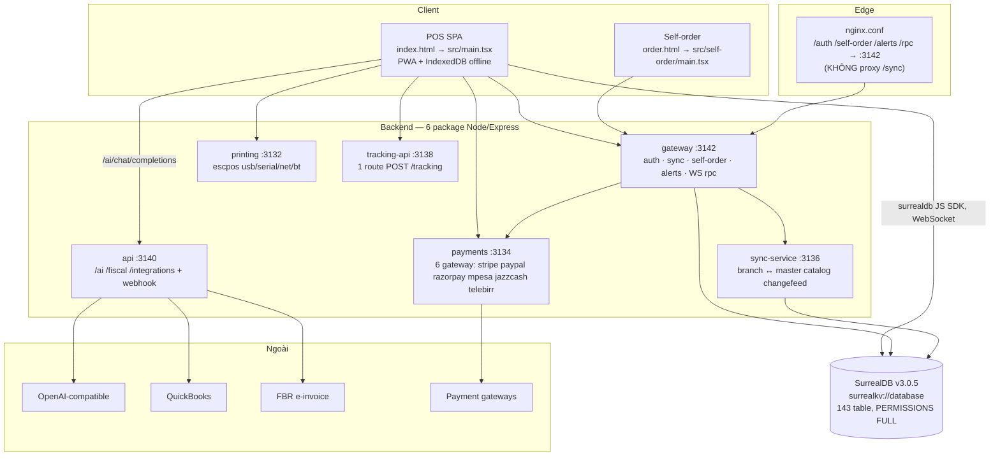
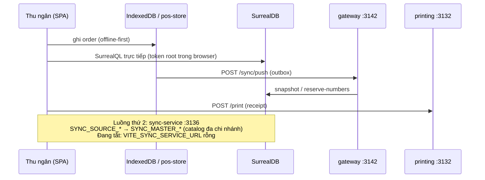
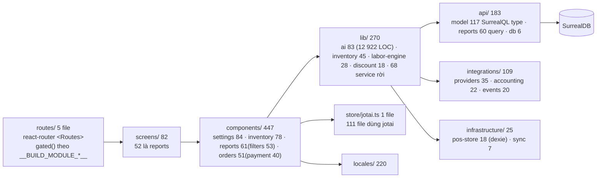
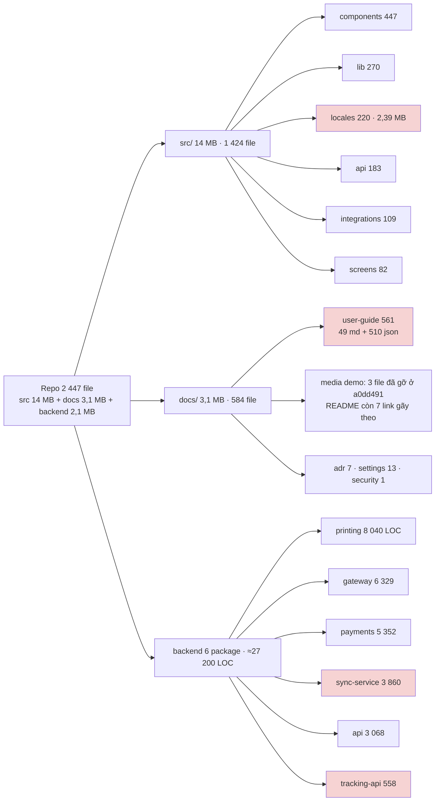
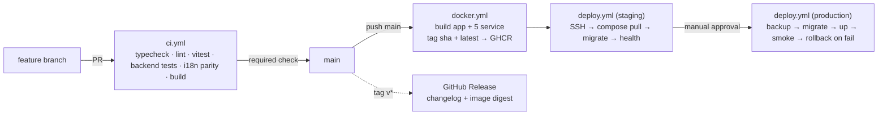
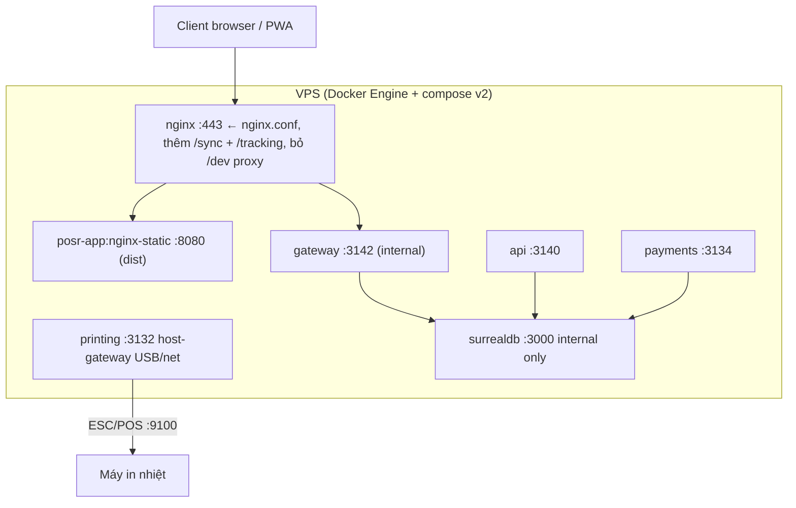

# Kế hoạch thu gọn dự án Restaurant Manager → `restaurant-manager`

Tài liệu này là kế hoạch, chưa phải kết quả. Số liệu đo trực tiếp trên working tree, branch `main`, remote `https://github.com/soncnjp181006/restaurant-manager.git`.

**Repo đang chuyển động trong lúc lập kế hoạch.** Đầu phiên làm việc HEAD là `778d4a3` ("Initialize", 21:47 +07); commit `a0dd491` ("update docs") gỡ thêm 5 file: `LICENSE`, `HARDENING-PATCH.md`, `docs/demo.mp4`, `docs/demo.gif`, `docs/demo-poster.png`. Bảng dưới đo ở `a0dd491`; cột "(tại `778d4a3`)" giữ lại số của lần đo đầu để giải thích các con số chênh nhau trong tài liệu.

**Trạng thái chốt liên kết chuẩn (đo lại cuối phiên 2026-10-30):** `git ls-remote https://github.com/soncnjp181006/restaurant-manager.git` trả `refs/heads/main = refs/HEAD = 5ecb15e`, trùng HEAD local, repo **Public**, tổng cộng 5 commit. `package.json` giờ khai báo `repository` + `homepage` trỏ về liên kết đó (trước đây repo không tự khai báo URL nào), `README.md` dùng nó cho `## Links` và `git clone`. Toàn bộ dấu vết nguồn gốc bản gốc — repo upstream cũ, domain cá nhân bên thứ ba, trang demo đang chạy, ảnh/video hosted ngoài, playlist YouTube, email liên hệ thương mại, hostname tailnet trong `vite.config.ts`, và câu persona AI tự nhận tác giả — đã bị gỡ khỏi working tree, không thay bằng tên mới. Chi tiết cụ thể của các giá trị đó **không** ghi lại trong tài liệu này để repo không tự tố nguồn gốc của chính nó; chúng chỉ còn trong lịch sử commit (xem §4.3).

| Hạng mục | Giá trị đo được |
|---|---|
| File được track | 2 447 (tại `778d4a3`: 2 449) |
| `src/` (frontend) | 14 MB, 1 424 file |
| `docs/` | 3,1 MB, 584 file = 510 `.json` + 74 `.md` (tại `778d4a3`: 6,4 MB / 587 file, chưa gỡ media) |
| `src/locales/` | 220 file = 10 ngôn ngữ × 22 namespace, 2,39 MB |
| Backend packages | 6 (`api`, `gateway`, `payments`, `printing`, `sync-service`, `tracking-api`) ≈ 27 200 LOC |
| `migrations/` | 100 file (81 `.surql`: 76 có `DEFINE/REMOVE`, 17 có thao tác data) |
| Workflow CI | 2 file, cả 2 tham chiếu thư mục `desktop/` **không tồn tại** |
| Ngôn ngữ có sẵn | en, es, tr, pt-BR, fr, nl, de, it, ar, ru — **không có tiếng Việt** |
| Link nội bộ trong `README.md` + `docs/**/*.md` | 289 link: **21 OK, 268 gãy** (chiếm ở §2.8) |

Kết luận chỉ đạo: dự án không "thừa code" theo nghĩa feature ngoài trời; nó thừa ở **bản sao trùng lặp** (auth middleware ×5 byte-identical, Surreal client ×5, thư viện data cùng vai trò ×2), **tài sản một lần** (locale 9 thứ tiếng cần bỏ, script sinh locale đã chạy xong, guide 510 JSON), và **tầng CI/CD mô tả một app đã bị xoá** (Tauri desktop).

---

## 1. Sơ đồ dự án

### 1.1 Bức tranh tổng thể

Điểm đáng chú ý về mặt kiến trúc: frontend **nói chuyện trực tiếp với SurrealDB** — một instance `new Surreal()` duy nhất ở `src/providers/database.provider.tsx:114`, SDK được import trong 30 file, còn 6 backend chỉ là vệ tinh cho các việc mà trình duyệt không làm được (in vật lý, webhook, gọi LLM giữ key, đa chi nhánh). Đây là lý do `api` và `gateway` không thể nhập làm một, nhưng `tracking-api` thì có thể.

### 1.2 Port và đường đi thực của dữ liệu

Ngoài ba đường sync, từ 2026-10-30 có thêm một nhánh ghi một chiều: `tracking :3138` vẫn ghi bảng
`tracking` vào SurrealDB như cũ, và **nếu** được cấp biến `TRACKING_PG_*` thì ghi thêm bản sao vào
PostgreSQL `tracking_events` (tuỳ chọn, chỉ qua `docker-compose.yml` + `docker-compose.analytics.yml`,
không màn hình nào đọc — xem Phase 5 và ADR 0006).

Ba đường sync cùng tồn tại — đây là chỗ chồng chéo lớn nhất cần quyết định (xem §3 Phase 3):

| Đường | Code | Vai trò thật | Trạng thái |
|---|---|---|---|
| A | `gateway/src/sync*.js` + `src/infrastructure/sync/` | terminal ↔ gateway, outbox khi mất mạng | đang dùng |
| B | `sync-service/` (3 860 LOC) | chi nhánh ↔ cloud, catalog | **không bật** (`VITE_SYNC_SERVICE_URL` để trống) |
| C | `src/lib/catalog-sync-tables.ts` + `catalog-override-fields.ts` | bảng/field được sync, trùng lặp tay với B | trùng lặp, comment tự thừa nhận |

### 1.3 Phân tầng frontend

### 1.4 Cơ chế gating module (thứ giúp "thu gọn" không phá production)

15 module: `menu, orders, summary, kitchen, order_display, delivery, closing, inventory, admin, reports, tips, accounts, hr, integrations, settings`. Cờ `VITE_APP_MODULES` / `VITE_APP_MODULES_EXCLUDE` được nạp **lúc build** (`vite.config.ts:14-17` → `define`), tiêu thụ ở `lazy-screens.ts` (66 tham chiếu) và `app.routes.tsx` (66 tham chiếu). Tắt module ⇒ không tạo chunk, không đăng ký route, ẩn sidebar/tab.

Hệ quả cho kế hoạch: gating chỉ cắt được **chunk**, không cắt được **tree**. Toàn bộ `src/api/**`, component, locale key vẫn nằm trong repo. Muốn giảm dung lượng thật sự phải xoá file, không phải tắt cờ.

### 1.5 Bản đồ khối lượng

Khối tô đỏ là khối co gọn nhất mà không đụng nghiệp vụ: locale 8 thứ tiếng, guide JSON đa ngôn ngữ, `sync-service` chưa bật, và `tracking-api` 1 route.

---

## 2. Hiện trạng: những gì đã lỗi thời (có bằng chứng)

### 2.1 i18n — yêu cầu EN + VI

`src/lib/languages.ts:8-19` khai báo 10 ngôn ngữ, `SUPPORTED_LANGUAGES` không có `vi`. Tìm `vi` / `Vietnamese` / `Tiếng Việt` trong toàn bộ `src/`, `scripts/`, `shared/` → **0 kết quả**. Vì vậy "hỗ trợ tiếng Việt" là **việc thêm mới**, không phải việc giữ lại.

Khối phải xoá: `src/locales/{ar,de,es,fr,it,nl,pt-br,ru,tr}` = 9 thư mục × 22 file = 198 file, 2,18 MB. Khối phải dịch sang `vi`: 22 namespace, **4 614 khoá lá** đo từ `src/locales/en`.

Các điểm chạm ngôn ngữ nằm ngoài `src/locales` (phải sửa đồng thời, nếu không parity check sẽ đỏ): `src/lib/languages.ts` (danh sách + `DEFAULT_TEXT_DIRECTION` + RTL), `src/lib/i18n.ts:34` (`localeFolder` hard-code `pt-BR`), `src/components/user_settings/language.tsx:41` (`lang.code === 'ar' ? 'rtl'`), `src/lib/order-ready-announcement.ts`, `src/lib/discount-engine/i18n-options.ts`, `src/lib/access.rules.i18n.ts`, `src/lib/ai/user-guide.ts` + test của nó, `scripts/i18n-verify-parity.mjs` (danh sách ngôn ngữ suy ra từ `readdirSync` — sẽ tự ổn sau khi xoá thư mục), 3 script `i18n-backfill-*.mjs`, và `docs/settings/language-settings.md`.

Bên tài liệu: `docs/user-guide/locales/` 10 thư mục × 51 file = 510 JSON (1,43 MB), `docs-automation/capture.mjs` chạy 10 ngôn ngữ, và ≈20 file generator một lần.

Ba bề mặt i18n mà bộ đếm file locale **không** lộ ra, và là lý do "xoá 9 thư mục" chưa phải là "còn EN + VI": (a) `src/lib/ai/tools/write-intent-i18n.ts` nhúng từ khoá nhận diện ý-ghi của 9 ngôn ngữ cho assistant Kashif, nhưng không có từ Việt nào; (b) `src/self-order/` (màn hình QR khách tự đặt món) không dùng i18next, chuỗi Anh hard-code trong `app.tsx`/`payment.tsx`; (c) `index.html:2` + `order.html:2` + manifest trong `vite.config.ts:41-43` cố định tiếng Anh.

### 2.2 Trùng lặp backend (đo bằng md5 và LOC)

| Bản sao | Vị trí | Chi phí |
|---|---|---|
| `session-auth.middleware.js` **byte-identical** (md5 `aef3a388…`) | `api/src/lib`, `payments/src/lib`, `printing/`, `tracking-api/src` + `shared/` | 114 dòng × 5 = 570 |
| Surreal client tự viết | `api` 69, `gateway` 126, `payments` 70, `sync-service` 74, `tracking-api` 48 | 387 dòng, 5 biến thể phân kỳ |
| `logger.js` / `response.js` / `request-log.middleware.js` | `api` + `payments` | trùng |
| Đường payment | `payments/` service ↔ `src/components/orders/payment/remote/gateways/*` (6 gateway phía browser) | 2 lần tích hợp cùng 6 nhà cung cấp |
| Compose của printing | 3 file (`docker-compose.yml`, `.standalone.yml`, `.standalone.usb.yml`) cho 1 service, cộng `Dockerfile` + `Dockerfile.https` và **cả `bun.lockb` lẫn `package-lock.json`** trong cùng thư mục | incoherent |

### 2.3 Dependency trùng ở `package.json`

| Cặp | Số file import thực trong `src/` | Kết luận |
|---|---|---|
| `react-query@3` vs `@tanstack/react-query@5` | 0 vs 8 | `react-query` bỏ được ngay |
| `react-table@7` vs `@tanstack/react-table@8` | 0 vs 60 | `react-table` + `@types/react-table` bỏ được ngay |
| `antd@6` vs `react-aria-components` vs tailwind | 7 file chạm SDK thật (`app.tsx`, `lib/antd-theme.ts`, 6 picker trong `components/common/antd/`) vs 53 vs toàn cục | antd **chỉ** cho họ date/time picker, và 30 file consumer đều đi qua wrapper `components/common/antd` → một seam sạch để thay, nhưng đó là redesign nên xếp ở §7, không vào Phase 2 |
| `classnames` vs `clsx` vs `tailwind-merge` | 6 vs 1 vs wrapper `lib/utils.ts` | `clsx` chỉ 1 file; gộp cả hai về `tailwind-merge`+`clsx` rồi xoá `classnames` |
| `dexie@4` vs `idb-keyval@6` | 1 (`infrastructure/pos-store/db.ts`) vs 7 | dexie chỉ sống ở 1 file — cân nhắc viết lại sang `idb-keyval` để bỏ 1 dep, nhưng pos-store là hạ tầng offline nên phải có test migrate |
| `lodash` | 15 file, có `overrides` ở `package.json:127` | đang dùng thật, giữ |

`bun.lockb` **và** `package-lock.json` (248 KB) cùng được track: hai nguồn chân lý cho một cây dependency.

### 2.4 Dead code phía frontend

18 ứng viên đã được kiểm chứng lại bằng 2 chiều: grep câu lệnh `import/from` theo đường dẫn (kết quả 0) **và** grep symbol export (kết quả 0). Liệt kê dưới đây là số đã đo, không phải phỏng đoán.

Components: `summary/summary.tsx`, `inventory/stores/index.tsx`, `inventory/common/document.print.modal.tsx`, `inventory/kitchen_reconciliation/csv.import.tsx`, `reports/ai/ai.tools.used.tsx`, `common/input/keyboard.tsx`, `common/input/checkbox.intermediate.tsx`, `common/react-aria/{select,datepicker,date.range.picker,calendar}.tsx` (họ date đã bị `common/antd` thay), `menu/image.ts`.
Screens/hooks/lib: `screens/lock.tsx`, `hooks/{useFetchRow,useFetchSettings,useProductionRecipe,useStoreLocations}.ts`, `lib/{request,invoice,order-tax.service,pos-split-project}.ts`, `lib/inventory/costing.service.ts`, `lib/ai/db.client.ts`.
Orphan model type: `src/api/model/{tip_distribution,order_merge,order_split,payment_webhook,day_closing,modifier_group_dish,kitchen_complimentary_item,kitchen_staff_meal,kitchen_stock_count,kitchen_waste,store}.ts`.
Barrel không ai nhập: `integrations/index.ts`, `integrations/accounting/index.ts`, `integrations/configuration/schema.ts`, `integrations/security/secret-store.ts`, `infrastructure/sync/index.ts`, `lib/{data-import,discount-engine,labor-engine}/index.ts`, `lib/inventory/purchase-cost/index.ts`.

### 2.5 Tài sản một lần nên rời repo

`docs-automation/wave10-translations.mjs` (16 446 dòng prose nhúng trong code) + `admin-wave9-translations.mjs` + `wave10-en-chapters.mjs` + 8 file `generate-*-locales.mjs` + 3 file `build-wave10*`/`apply-wave10-catalog`/`gen-wave10-lang-modules` + `_wave10-chunks/` (3 file) + `translate-ptbr-langs.mjs` — tổng ≈20 file một lần, **0 inbound reference**.

`scripts/` có 11 file `.mjs`: chỉ 2 cái đáng ở lại (`i18n-verify-parity.mjs`, `i18n-verify-keys.mjs` — cổng kiểm tra). 9 còn lại là một lần: 3 `i18n-backfill-{discount,parity,toast}.mjs`, `i18n-migrate-targets.mjs`, `generate-discount-patches.mjs`, `migrate-discounts.mjs`, `seed-discounts.mjs`, `backfill-order-discounts.mjs`, `sync-admin-locales.mjs` (1 138 dòng, dùng `import.meta.dir` chỉ chạy trên Bun, không có npm script) — cộng 2 thư mục patch `i18n-discount-patches/` + `i18n-parity-patches/` (18 file JSON). Trong số đó 5 file vẫn được npm tham chiếu (`package.json:14,18-20`) nên phải xoá kèm script entry.

### 2.6 CI/CD chết hoàn toàn

`desktop-windows.yml` có 14 dòng nhắc `desktop`, `desktop-linux.yml` có 11. Cả hai build `desktop/src-tauri`, chạy `bun run desktop:build`, cache `desktop/src-tauri -> target`. **Không tồn tại thư mục `desktop/`**, và `desktop:build` không có trong `package.json` scripts. Hai workflow này không thể xanh; chúng chỉ đốt runner Windows (timeout 120 phút). README thì **không hề nhắc** tới app desktop — nghĩa là CI đang mô tả một sản phẩm khác.

Không có workflow nào cho chính app: không build, không lint, không test, không image, không deploy.

### 2.7 Hạ tầng deploy lệch với code

`docker-compose.yml`: `:150,152` trỏ `./tracking/.env` và `./tracking/.env.local` trong khi thư mục thật là `tracking-api` → không bao giờ nạp (may là `required: false`). `:231` expose `"${GATEWAY_PORT}:3142"` nhưng `GATEWAY_PORT` chỉ có ở `gateway/.env.example:5`, không có ở `.env.example` gốc → biên dịch rỗng, phá đúng ý đồ loopback-only ghi ở `:227-230`. `:245-246` bind `./backups/surrealdb` (không tồn tại) và `:247` mount `/var/run/docker.sock` vào container backup. `:63-66` cho printer nạp `./api/.env` — sai service, và `printing` không có `.env.example` riêng. Service `app` chạy `bun run dev` trên 5173, tức compose hiện tại là **dev stack đội lốt production**. `nginx.conf` có 0 tham chiếu trong compose. `migrations/` không có runner tự động: `run-prod-migrations.cjs:68-134` giữ `MIGRATION_PLAN` 47 entry (41 `.surql` + 6 script Node), còn **40 file `.surql` trên đĩa không nằm trong plan** (đo bằng diff listing vs mảng plan; chiều ngược lại — entry trong plan nhưng mất file — là 0).

### 2.8 Liên kết gãy trên GitHub (rào cản publish)

Commit `a0dd491` hiện tại không còn `LICENSE` và `HARDENING-PATCH.md` nữa (bạn xác nhận việc gỡ này là chủ ý), nhưng `README.md:28` và `:233` vẫn link `[LICENSE](LICENSE)` và tuyên bố giấy phép PSAL v1.0; `package.json:5` ghi `"license": "SEE LICENSE IN LICENSE"`. Vì gỡ là chủ ý nên hướng sửa là **xoá hoặc viết lại ba chỗ tuyên bố giấy phép trong README + package.json**, không phải khôi phục file — trừ khi bạn muốn giữ PSAL.

Đo bằng script phân tích link nội bộ trên `README.md` + 74 file `docs/**/*.md`: **289 link, chỉ 21 cái trỏ tới file tồn tại, 268 gãy**.

**Đo lại sau khi gỡ link (2026-10-30, cùng script, cùng tập 75 file `README.md` + `docs/**/*.md`):** link nội bộ còn **26**, cả 26 trỏ tới file tồn tại, **0 gãy**, và **0 link nào trỏ sang domain bên thứ ba**. Số gãy giảm 261 → 0 bằng cách: gỡ 256 tham chiếu ảnh không tồn tại (toàn bộ là dòng ảnh đơn độc trong `docs/user-guide/*.md` + `docs/readme.md`, ảnh thật nằm ở `docs/user-guide/images/` bị `.gitignore` nên chúng chưa bao giờ render); sửa 2 link source path trong `docs/integrations/framework.md` (thiếu `../../` nên gãy dù file đích có tồn tại); bỏ 1 link thư mục `images/` trong `docs/user-guide/README.md`; và bỏ 2 link `LICENSE` trong `README.md` (text tuyên bố PSAL giữ nguyên, chỉ bỏ pointer tới file không có). Không có ảnh nào bị xoá khỏi nội dung — chỉ các dòng trỏ tới file không tồn tại.

Hai link ngoài trong khối media của `README.md` (dòng 178-179 bản gốc) đã được rà và xử lý: video demo host trên domain cá nhân của bên thứ ba, và một playlist YouTube mà ID chỉ dài 11 ký tự trong khi ID thật dài 34 — gần như chắc chắn đã bị cắt sai. **Trạng thái 2026-10-30: cả hai link và cả khối "See it in action" đã bị gỡ**; tài liệu này cố ý không ghi lại URL/ID cũ, vì ghi lại thì chính tài liệu sẽ tố nguồn gốc repo.

`SECURITY.md` còn ghi trạng thái mở: `PERMISSIONS FULL` trên **143 table**, token quyền root chạy trong browser, credential payment không mã hoá (`SECURITY.md:50-60`).

`README.md:169` cũng là chỗ sẽ sai ngay sau Phase 1 — nó phải đổi thành "English, Tiếng Việt".

### 2.9 Cổng kiểm thử không đủ che

`vitest.config.ts` chạy 75 file `*.test.ts(x)` trong `src/` (cộng 1 file `.test.cjs`) với `maxWorkers: 1, fileParallelism: false`. 28 file test backend tồn tại nhưng **chỉ `sync-service` có npm script test** (`node --test src/*.test.js`); `api`, `gateway`, `payments`, `printing`, `tracking-api` không có script nào. `npm run test:sync` gọi `node --test` trên 3 file `.cjs` mà một trong số đó (`src/infrastructure/sync/conflict-auto-retry.test.cjs`) cũng khớp glob của vitest — hai harness chạy chồng nhau. Playwright chỉ dùng để chụp ảnh tài liệu, không có e2e UI. Không có CI nên **không gì trong số này từng được chạy tự động**.

### 2.10 Vụn lệch nhỏ nhưng có thể gây lỗi thật

- **Port payment ba nơi ba giá:** `payments/server.js:26` mặc định `3134`, `.env.example:55` cũng `3134`, nhưng `src/lib/payment.service.ts:4` fallback `http://localhost:3133` và `payments/README.md:18` vẫn ghi "listens on 3133 by default". Comment ở `payments/server.js:24-25` tự thừa nhận chỗ này từng lệch và "chỉ chạy được nhờ compose override". Hệ quả: thiếu `VITE_PAYMENT_SERVER_URL` thì browser gọi vào cổng không có ai nghe, và lỗi hiện ra ở UI chứ không ở log service.
- **`history.txt` (28 dòng) vẫn được track**, nội dung là ghi chú thử SurrealQL (`RETURN does - not;`, `SELECT * FROM order WHERE floor = floor:⟨does-not⟩;`) — rác phiên làm việc, không phải tài liệu. `.freebuff/project-id` đã vào `.gitignore`, còn `history.txt` thì chưa.
- **`README.md:209`** đúng về gateway 3142 (không phải 8000) nhưng link `docs/security/GATEWAY.md`; cùng nhóm lỗi liên kết với `LICENSE` và `docs/images/` ở §2.8, cần kiểm mọi link nội bộ trước khi publish.

---

## 3. Kế hoạch thu gọn theo giai đoạn

Nguyên tắc thứ tự: làm nền xanh trước khi cắt, mỗi giai đoạn một PR review được, và **cắt gì thì cổng kiểm tra phải chứng minh cái còn lại chạy được**. Không xoá tính năng nghiệp vụ nào — chỉ xoá bản sao, tài sản một lần, và code 0 tham chiếu.

### Phase 0 — Nền xanh (không xoá gì)

1. Bổ sung `LICENSE` đúng nội dung PSAL v1.0 mà `README.md:233` tuyên bố, hoặc sửa README sang giấy phép có thật. Đây là lỗi pháp lý hiển thị công khai trên repo.
2. Sửa 268 link gãy đã đo ở §2.8 theo nhóm: (a) `README.md` — 6 PNG trong `docs/images/` (thư mục rỗng) hoặc đưa ảnh vào, hoặc xoá khối "Screenshots"; `docs/demo.gif` đã bị gỡ nên bỏ luôn dòng `README.md:176` hoặc khôi phục file; (b) `docs/user-guide/*.md` — 240 link ảnh trỏ vào `docs/user-guide/images/` vốn bị `.gitignore`, cách rẻ nhất là xoá dòng ảnh chứ không phải tắt ignore; (c) `docs/integrations/framework.md` — 2 path source đã đổi tên; (d) 2 link ngoài ở khối media của `README.md` (domain cá nhân của bên thứ ba + playlist YouTube ID bị cắt) — **đã gỡ cùng cả khối "See it in action" ngày 2026-10-30**, không giữ bản ghi URL.
3. Chọn một trình quản lý package: giữ `bun.lockb` rồi xoá `package-lock.json` (vì CI và compose đều dùng Bun qua `oven-sh/setup-bun`), hoặc ngược lại. Không giữ cả hai.
4. Xoá 2 workflow desktop chết (Phase 5 thay bằng CI thật, nhưng ở bước này chúng chỉ gây nhiễu).
5. Thêm `npm run check` cục bộ: `tsc --noEmit && eslint . --max-warnings 0 && vitest run && node scripts/i18n-verify-parity.mjs && node scripts/i18n-verify-keys.mjs`, cộng script `test` cho 5 package backend còn thiếu.
6. Sửa ba vụn ở §2.10: đổi fallback `src/lib/payment.service.ts:4` từ `3133` → `3134` và viết lại `payments/README.md:18` theo `payments/server.js:26`; `git rm history.txt` + thêm vào `.gitignore`; chạy một script nhỏ phân tích mọi link nội bộ trong `README.md`/`docs/**/*.md` và fail nếu có link gãy (đây chính là thứ sẽ bắt được lỗi `LICENSE` và `docs/images/` ngay khi nó xảy ra, thay vì chờ mắt người).

**Cổng:** `npm run check` xanh trên commit sạch, từ máy dev và từ CI trống. Ghi lại số liệu nền (số file, số LOC, dung lượng) để các phase sau so sánh.

### Phase 1 — i18n còn English + Tiếng Việt — ĐÃ THỰC HIỆN (2026-10-30)

Trạng thái: các bước 1–9 và 11 dưới đây đã áp dụng trong working tree.
Đã đo lại sau khi làm: `src/locales/` còn 2 thư mục (`en` 22 file / 263 KB, `vi` 22 file / 291 KB)
= 44 file / 558 KB, giảm 198 file và 2,18 MB; `docs/user-guide/locales/` còn `en`
(51 file / 278 KB), giảm 459 file và 1,27 MB; số file được track giảm 2 447 → 1 790.
Cổng parity báo `Locale parity OK for 1 languages × 22 namespaces`;
`node scripts/i18n-check-pair.mjs vi all` báo 4 610 khoá lá, 0 lỗi cấu trúc, 30 giá trị
trùng tiếng Anh — toàn bộ là token `{{...}}`, viết tắt (VID/PID/PIN/KOT/AI/CSV/FIFO/FEFO/ESC-POS),
đơn vị ("58 mm") hoặc brand Restaurant Manager, không có chuỗi nào bị bỏ dịch.
Hai việc chưa làm, cần quyết định: **bước 10** (nối i18next cho `src/self-order/`,
hiện vẫn chỉ tiếng Anh) và bản `vi` của guide Kashif (`docs/user-guide/locales/vi/`
chưa tồn tại nên tool fallback sang tiếng Anh).

1. Xoá 9 thư mục trong `src/locales/` (`ar de es fr it nl pt-br ru tr`), 198 file / 2,18 MB.
2. Sửa `src/lib/languages.ts`: `SUPPORTED_LANGUAGES = [{en}, {vi}]`; xoá `DEFAULT_TEXT_DIRECTION`/`AppTextDirection`/`TEXT_DIRECTIONS`/`isTextDirection` hoặc giữ với giá trị hằng `ltr`. Vì chỉ còn 2 ngôn ngữ LTR, toàn bộ nhánh RTL (`language.tsx:41`, `i18n.ts:34`, các provider đặt `dir`) mất lý do tồn tại — xoá để lại code path đơn.
3. `src/lib/i18n.ts`: bỏ `localeFolder` (hàm đặc biệt `pt-BR`), load động theo thư mục còn lại.
4. Dịch 22 namespace sang `vi` (4 614 khoá). Chiến lược dịch để không vỡ nghĩa nghiệp vụ: giữ nguyên identifier/hành vi trong placeholder; `en` là chân lý cho parity; thuật ngữ POS nên nhất quán (ticket=hoá đơn, floor=khu vực, shift=ca, closing=chốt ca, tender=thu ngân). Ưu tiên 4 namespace loaded sớm (`common, auth, validation, toast` ở `i18n.ts:74`) để UI chạy được trước, phần còn lại theo thứ tự tần suất màn hình.
5. `scripts/i18n-verify-parity.mjs` tự suy danh sách từ `readdirSync` nên không cần sửa; nhưng cần **đảo chiều cổng**: hiện nó so mọi lang với `en`, sau Phase 1 chỉ còn 1 lang được kiểm — thêm assert "số thư mục locale == 2 và tập tên == {en, vi}" để một lần xoá accidental cũng đỏ.
6. Tài liệu: xoá 9 thư mục `docs/user-guide/locales/` (459 file / ~1,27 MB); `docs-automation/capture.mjs` còn 2 ngôn ngữ; xoá ≈20 file generator một lần (đếm ở §2.5); dịch 49 chapter `docs/user-guide/*.md` sang `vi` nếu giữ tính năng tra cứu guide của Kashif (`src/lib/ai/user-guide.ts:144` glob trực tiếp vào `docs/user-guide/locales/*/*.json` — thư mục `vi` bắt buộc phải có nếu không tool sẽ trả rỗng).
7. Sửa `README.md:169` → "**Multi-lingual** — English, Tiếng Việt"; `docs/settings/language-settings.md`; `.env.example` (`VITE_DEFAULT_LANGUAGE` chỉ chấp nhận `en|vi`).
8. `src/lib/ai/user-guide.test.ts` và `src/lib/order-ready-announcement.ts`, `src/lib/discount-engine/i18n-options.ts`, `src/lib/access.rules.i18n.ts`: rà hard-code language code, thay bằng `isSupportedLanguage`.
9. **`src/lib/ai/tools/write-intent-i18n.ts` (42 dòng)** — bộ từ khoá routing write-tool cho Kashif, nhúng verb + noun của 9 thứ tiếng (`ekle/oluştur`, `hinzufügen`, `añadir`, `ajouter`, `aggiungere`, `toevoegen`, `adicionar`, `добавить`; `yemek`, `gericht`, `plato`, `piatto`, `prato`, `блюдо`; `masa`/`tisch`/`mesa`, `indirim`/`rabatt`/`descuento`/`remise`/`sconto`/`скид*`). Xoá locale không tự xoá file này; để nguyên thì assistant vẫn nhận 8 ngôn ngữ chết mà **không nhận tiếng Việt**. Việc thật: thay danh sách bằng en + vi (`thêm`, `tạo`, `mới`, `cập nhật`, `sửa`, `đổi`, `gán`, `món`, `mẹt`, `nhóm`, `bàn`, `giảm giá`, `khuyến mãi`), và **port 4 test đang assert tiếng Thổ Nhĩ Kỳ** trong `write-intent-i18n.test.ts:9-15,26-31,34-40` sang prompt Việt — không xoá test, vì đó là cổng kiểm tra routing write-tool; test Việt đồng thời chứng minh keyword mới hoạt động.
10. **`src/self-order/` (7 file) chưa hề có i18n.** `app.tsx` và `payment.tsx` hard-code chuỗi Anh ("View your order", "Continue to payment", "Pay with", "Thank you for dining with us", "Payment not completed", "Special requests"…), 0 lần gọi `useTranslation`. Đây là bề mặt công khai mà khách dùng điện thoại quét QR chạm vào, nên "hỗ trợ tiếng Việt" chỉ thật khi nó được tính: hoặc nối `SelfOrderApp` vào `i18n` hiện có + thêm namespace `self_order` (22 → 23, parity gate tự phủ), hoặc chấp nhận self-order EN-only một cách có ý thức và ghi rõ trong README. Quyết định này nằm ở §6.
11. `index.html:2` và `order.html:2` đều hard-code `<html lang="en">`; `vite.config.ts:41-43` đặt manifest `name`/`description` bằng tiếng Anh cứng. Sau khi `vi` thành default cho một số installation, `lang` phải theo `DEFAULT_LANGUAGE` (hoặc cập nhật lúc boot qua `document.documentElement.lang` như provider `dir` cũ vẫn làm), còn manifest thì cân nhắc `name`/`short_name` song ngữ.

Giảm được: ~3,45 MB và ~660 file. Rủi ro chính: dịch thiếu khoá làm i18next fallback về `en` một cách âm thầm → chính vì thế cổng parity phải chạy trong CI (`ci.yml` ở §4.2) và assert tập ngôn ngữ.

### Phase 2 — Dependency và dead code

1. Bỏ `react-query`, `react-table`, `@types/react-table` (0 import, đã đo). Gộp 6 file đang `from 'classnames'` và 1 file `from 'clsx'` về `clsx` + `cn()` trong `src/lib/utils.ts`, rồi bỏ `classnames`.
2. Xoá toàn bộ danh sách dead code §2.4 (≈40 file gồm cả 11 model type orphan và 9 barrel không ai nhập).
3. `migrations/`: chuyển 17 `.surql` data-patch một lần vào `migrations/applied/` (archive, vẫn apply được cho DB cũ) và xoá khỏi tree nếu `MIGRATION_PLAN` đã ghi nhận; mục đích là giảm 100 file xuống còn schema thuần.
4. `scripts/`: xoá 9 script một lần (`i18n-backfill-{discount,parity,toast}.mjs`, `i18n-migrate-targets.mjs`, `generate-discount-patches.mjs`, `migrate-discounts.mjs`, `seed-discounts.mjs`, `backfill-order-discounts.mjs`, `sync-admin-locales.mjs`) + 2 thư mục patch JSON (18 file) + 4 npm-script entry tương ứng ở `package.json:14,18-20`; giữ đúng 2 script verify.

Cổng: `tsc --noEmit` xanh + bundle size (`rollup-plugin-visualizer` đã có trong devDeps) không tăng + `npm run build` tạo `dist` và self-order entry vẫn hoạt động.

### Phase 3 — Hợp nhất backend

1. **Tạo `packages/` (hoặc `shared/` đã có sẵn chỗ) cho server-lib**: `session-auth.middleware`, `surreal-client`, `logger`, `response`, `request-log` — xoá 5 bản sao auth (570 dòng) và 5 bản sao Surreal client (387 dòng), để 1 bản + test. Đây là phần ít rủi ro nhất vì các bản đã byte-identical hoặc cùng hợp đồng.
2. **Nuốt `tracking-api` (558 LOC, 1 route) vào `gateway`**: cùng DB, cùng pattern auth, nginx đã proxy `/alerts` rồi thêm `/tracking`. frontend chỉ đổi `VITE_TRACKING_SERVER_URL` → gateway base. Lưu ý 7 file report phía `src/api/reports/**` đọc thẳng table `tracking` qua Surreal — phải giữ tên table để không phá report.
3. **Quyết định `sync-service` (3 860 LOC)**: không bật (`VITE_SYNC_SERVICE_URL` rỗng), không có script npm, không có CI. Hoặc đưa vào `.env.example` + bật + test (nếu đa chi nhánh là lộ trình thật), hoặc gỡ khỏi compose + archive sang `attic/`. Không để ở trạng thái "sống nửa" — nó là gánh nặng bảo trì lớn nhất tính theo LOC/hữu dụng.
4. Gộp 3 compose file của `printing` thành 1; bỏ một trong hai lockfile trong `printing/`; tạo `printing/.env.example` (service đang đọc `./api/.env` ở `docker-compose.yml:63-66`).
5. Sửa `docker-compose.yml` §2.7: `./tracking/.env` → `./tracking-api/.env`; khai báo `GATEWAY_PORT` trong `.env.example` mặc định `127.0.0.1:3142` (không phải empty interpolation); path `./backups/surrealdb` tạo sẵn qua entrypoint hoặc bỏ mount; bỏ mount docker.sock nếu backup có thể chạy từ host cron.

Cổng: mọi `VITE_*_SERVER_URL` trỏ tới service còn tồn tại; `docker compose config` pass; gọi `/health` từng service trong stack dựng được.

### Phase 4 — Tài liệu và docs-automation

`docs/user-guide` 561 file nhưng runtime chỉ đọc JSON cho AI tool; 49 file `.md` và pipeline Playwright sinh PDF chỉ phục vụ con người. Hai lựa chọn, cần chốt (§6):

- **Giữ** guide PDF: ở lại repo, nhưng `capture.mjs` còn 2 ngôn ngữ, và `docs/user-guide/images` + `dist` đã gitignored nên ảnh không bao giờ lên GitHub → README không được link vào chúng.
- **Bỏ** pipeline PDF: xoá `docs-automation/` (1,4 MB, 80 file) + 4 npm script `docs:guide*`, giữ JSON `en`+`vi` vì Kashif `lookup_user_guide` cần nó.

Đây là chỗ giảm nhiều file nhất mà không đụng nghiệp vụ: `docs/` + `docs-automation/` = 667 file / 7,8 MB, chỉ để phục vụ tính năng "AI tra hướng dẫn".

### Phase 5 — PostgreSQL: chỉ nhận một phần (ĐÃ THỰC HIỆN 2026-10-30)

Yêu cầu "dùng PostgreSQL" không thể áp lên toàn bộ hệ thống mà không phá §7 (không đổi engine) và không viết lại 6 màn report đang đọc `SELECT * FROM tracking` thẳng từ Surreal. Phần duy nhất nhận Postgres là **mirror của log tracking/activity**, thiết kế ghi trong [`docs/adr/0006-postgres-tracking-mirror.md`](docs/adr/0006-postgres-tracking-mirror.md):

| Điểm | Thực hiện |
|---|---|
| Phạm vi | `tracking-api` ghi thêm mỗi event vào bảng `tracking_events` (Postgres). Mọi bảng khác vẫn ở SurrealDB. |
| Nguồn đọc | Không đổi: report, cash audit, order lifecycle, sales dashboard, order detail, schema Kashif vẫn đọc `tracking` trong Surreal. |
| Bật/tắt | `TRACKING_PG_URL` hoặc `TRACKING_PG_HOST/PORT/DB/USER/PASS`. Để trống = không tạo pool, không kết nối, hành vi y hệt hôm qua. |
| Hỏng mirror | Không biến 201 thành 500: `writeTrackingEvent()` trả `{written, reason}`, ghi log và tăng bộ đếm hiển thị ở `GET /health` (`pgMirror`, `pgMirrorFailures`). |
| Schema | `CREATE TABLE IF NOT EXISTS` + 2 index (`created_at`, `(module, created_at)`) soi theo `2026_08_30_hot_path_indexes.surql`. **Không** thêm file nào vào `migrations/`. |
| Khoá | id client hợp lệ (`^[a-zA-Z0-9_-]{1,128}$`) thành `tracking_id` + `ON CONFLICT DO UPDATE` (đúng semantics CREATE-overwrite của Surreal); id không hợp lệ → UUID, giữ nguyên giá trị cũ trong `payload` jsonb. |
| Hạ tầng | `docker-compose.analytics.yml` tách riêng, dùng `-f docker-compose.yml -f docker-compose.analytics.yml`. Lý do: Compose nội suy `${VAR:?}` cho **mọi** service trong file kể cả khi profile ẩn nó — đặt Postgres vào file chính làm `docker compose up` mặc định fail với người không dùng Postgres (đo: lỗi `required variable TRACKING_PG_USER is missing`). Container chỉ bind `127.0.0.1`. |
| Dependency | `pg@8.23.1` chỉ ở `tracking-api` — bundle trình duyệt và 5 sidecar còn lại không đổi. |
| Test | `npm run test:tracking` = 28 test: 26 pass + 2 skip khi không có Postgres; 28/28 pass khi chạy với `postgres:16-alpine` thật (container xoá sau khi đo). |

### Tổng kết khối lượng giảm được sau Phase 1–4

| Chỉ số | Trước | Sau (ước) |
|---|---|---|
| File track | 2 447 | ≈1 700 nếu Phase 4 giữ guide; ≈1 550 nếu gỡ `docs-automation/` (80 file) |
| `src/locales` | 220 file / 2,39 MB | 44 file / ~0,45 MB |
| `docs/user-guide/locales` | 510 file / 1,43 MB | 102 file / ~0,3 MB |
| Backend package | 6 | 5 (hoặc 4 nếu gỡ `sync-service`) |
| Bản sao auth/Surreal client | 5 + 5 | 1 + 1 |
| Dependency trùng | 3 cặp | 0 |
| LOC xoá | — | ≈ 18 000 prose/duplicate/one-off |

---

## 4. Kế hoạch deploy lên `soncnjp181006/restaurant-manager` (branch `main`)

> **TRẠNG THÁI (2026-10-30): HOÃN TOÀN BỘ §4.2–§4.7.** Chủ repo chốt chưa deploy, chỉ chạy local.
> Toàn bộ mục 4 giữ nguyên làm thiết kế tham chiếu, nhưng **không tạo secret deploy nào** cho tới khi bật lại.
> Mục 4.0 dưới đây là phần đang áp dụng.

### 4.0 Chế độ hiện tại: chỉ chạy local — kiểm kê tác động của việc bỏ deploy

Bằng chứng đo trực tiếp trên working tree, không suy luận:

| Đối tượng | Trạng thái | ảnh hưởng nếu bỏ deploy |
|---|---|---|
| Workflow deploy | **không tồn tại**. `.github/workflows/` chỉ có `desktop-linux.yml` + `desktop-windows.yml`, cả hai `workflow_dispatch` thủ công và tham chiếu thư mục `desktop/` đã bị xoá → chết từ trước, không chạy trên push nào | Không gì thay đổi. Hai workflow này là *đóng gói desktop*, không phải deploy; vẫn cần xoá ở Phase 0 vì chúng đỏ |
| Secret deploy trên GitHub | Repo không tham chiếu biến `secrets.*` nào ngoài `secrets.GITHUB_TOKEN` (do Actions tự cấp, không xoá được) | Không có key deploy nào trong repo để gỡ. Nếu bạn đã tự tạo secret trong Settings → Secrets and variables → Actions, xoá ở đó không ảnh gì vì không workflow nào đọc |
| `nginx.conf` | Không được tham chiếu bởi `docker-compose.yml`, các `Dockerfile`, hay workflow nào (`git grep nginx.conf` trả về rỗng) | Chỉ phục vụ container production tương lai. để lại cũng vô hại |
| `docker-compose.yml` gốc | Chạy full stack local: `app` + `surrealdb` + `printer/payment/sync/tracking/api/gateway` + `backup` | **Phải giữ.** Đây là hạ tầng local, không phải deploy |
| `printing/Dockerfile`, `Dockerfile.https`, `docker-compose.standalone*.yml` | `printer` được root compose build từ `printing/Dockerfile` | Giữ `Dockerfile`; bản `.https`/standalone chỉ cần khi chạy máy in tách máy chủ |
| `migrations/scripts/run-prod-migrations.cjs` | Chỉ được gọi từ job deploy (mục 4.2) | Không chạy khi local; local dùng `apply-migration.cjs`/`latest.surql`. Giữ file, không ai tham chiếu |
| §4.3 secret (`DEPLOY_SSH_KEY`, `DEPLOY_HOST`, `DEPLOY_USER`, credential gateway) | Chưa từng tạo | **Huỷ khỏi kế hoạch hiện tại.** Chỉ còn biến môi trường local (bảng dưới) |

Biến môi trường vẫn cần khi chạy local (giá trị thật không commit; tạo trên máy bạn):

| Biến | Nơi đặt | Bắt buộc? | Cách lấy giá trị |
|---|---|---|---|
| `GATEWAY_JWT_SECRET` | `.env`, `gateway/.env`, `api/.env`, `payments/.env` (phải trùng nhau) | Có — `gateway/src/jwt.js:5` ném lỗi nếu thiếu, không có default | `node -e "console.log(require('crypto').randomBytes(48).toString('hex'))"` |
| `SURREAL_USER` / `SURREAL_PASS` | `.env` (root compose đọc để khởi động `surrealdb`) và các `.env` sidecar | Có — `${SURREAL_PASS:?...}` trong compose fail nếu trống | Tự chọn, phải nhất quán giữa các file |
| `SURREAL_URL`, `SURREAL_NS`, `SURREAL_DB` | mỗi service `.env` | Có | `ws://127.0.0.1:8000/rpc`, `posr`, `posr` |
| `VITE_GATEWAY_URL`, `VITE_APP_MODULES`, `VITE_DEFAULT_LANGUAGE`, `VITE_CURRENCY`, `VITE_DATE_*` | `.env.local` (frontend) | Không — code giờ có fallback; `VITE_DEFAULT_LANGUAGE` chỉ nhận `en`\|`vi` | Xem `.env.example` |
| `OPENAI_API_KEY`, `STRIPE_*`, `PAYPAL_*`, `RAZORPAY_*`, `JAZZCASH_*`, `QBO_*`, `PAYMENT_CREDENTIAL_ENCRYPTION_KEY` | `.env` của service tương ứng | Chỉ khi bật tính năng đó | để trống ⇒ tính năng tự tắt |

Hệ quả thực tế cần biết: hiện **không có file `.env` nào trên đĩa** (chỉ có `.env.example`), nên `npm run dev` frontend chạy được nhờ fallback vừa thêm, nhưng `gateway`/`api`/`payments` sẽ **từ chối khởi động** cho tới khi bạn copy example thành `.env` và điền `GATEWAY_JWT_SECRET` + `SURREAL_*`. Đây là hành vi fail-closed chủ ý, không phải lỗi.

### 4.1 Vì sao CI/CD hiện tại là "đồ lỗi thời"

Hai workflow duy nhất build app không còn tồn tại (`desktop/`). Đồng thời repo đã public-có-sẵn-code nhưng **mọi push vào `main` không chạy nổi một bước kiểm tra nào**: không `tsc`, không lint, không test, không build. Nghĩa là "deploy" hôm nay thực chất là copy thư mục lên máy và chạy `docker compose up` với service `app` ở chế độ `bun run dev`.

### 4.2 Kiến trúc pipeline mục tiêu

Bốn workflow, thay cho hai workflow chết:

| File | Trigger | Nội dung |
|---|---|---|
| `.github/workflows/ci.yml` | `pull_request` + `push` tới `main`, path filter | matrice bước: `bun install --frozen-lockfile`; `tsc --noEmit`; `eslint . --max-warnings 0`; `vitest run`; vòng qua 5 package backend chạy `node --test src` (thêm script `test` ở Phase 0); `node scripts/i18n-verify-parity.mjs` + `i18n-verify-keys.mjs` với assert tập ngôn ngữ = {en, vi}; `bun run build`; upload `dist` artifact; dựng `docker compose config -q` để bắt lỗi biến môi trường như `GATEWAY_PORT`. |
| `.github/workflows/docker.yml` | `push main` + tag `v*` | build image cho `app` (multi-stage, `vite build` + `nginx` serve tĩnh, **không** `bun run dev`), và từng backend service; push `ghcr.io/soncnjp181006/restaurant-manager/{app,gateway,api,payments,printing}@<sha>`; `latest` chỉ khi `main`. |
| `.github/workflows/deploy.yml` | `workflow_dispatch` chọn môi trường + `image tag/digest` | SSH tới host; `docker compose -f compose.prod.yml pull`; snapshot SurrealDB; chạy migration qua `run-prod-migrations.cjs`; `up -d`; smoke test `/health` từng service; nếu fail → `compose down` + restore ảnh/tag cũ, in log. |
| `.github/workflows/pages-guide.yml` (tuỳ chọn) | tag `v*` | render `docs/user-guide` (en+vi) sang HTML tĩnh, publish GitHub Pages, thay vì commit PDF. |

Branch protection cho `main`: yêu cầu `ci` xanh, 1 review nếu có cộng tác viên thứ hai, cấm force-push, linear history (Squash hoặc Merge commit — không rebase vì repo đã có history công khai).

### 4.3 Môi trường và secret — KHÔNG tạo key deploy ở giai đoạn này

Quyết định hiện tại: chỉ chạy local, nên **không** tạo GitHub Environments và **không** đặt secret deploy nào (`DEPLOY_SSH_KEY`, `DEPLOY_HOST`, `DEPLOY_USER`) — không có job nào đọc chúng, tạo ra chỉ thành khối tài sản phải xoay vòng sau này.

Những gì đã thực hiện trong working tree (2026-10-30), theo đúng tinh thần "bỏ key, giữ biến":

| File | Trước | Sau |
|---|---|---|
| `gateway/.env.example` | `GATEWAY_JWT_SECRET=` một chuỗi hex 96 ký tự commit sẵn | biến giữ nguyên tên, giá trị để trống + comment lệnh sinh key |
| `payments/.env.example` | cùng một chuỗi hex đó | như trên |
| `.env.example` (root) | `GATEWAY_JWT_SECRET=RUN_node_-e_..._TO_GENERATE` (nhìn như value, dài 78 ký tự nên **qua được** kiểm tra ≥32 ký tự của gateway nếu ai đó copy mà không đọc) | để trống, comment hướng dẫn đã có ở trên |
| `api/.env.example` | như root | để trống |

Ràng buộc còn nguyên: `gateway/src/jwt.js` không có default và yêu cầu ≥32 ký tự, nên mỗi máy phải tự sinh key. `SURREAL_USER`/`SURREAL_PASS` trong example vẫn là value placeholder tự nhận diện (`posr-local-dev-change-me`, `CHANGE_ME_BEFORE_DEPLOY`) và **cố ý giữ** — bộ compose local cần cặp giá trị nhất quán giữa `surrealdb` và các sidecar, đó là biến cấu hình chứ không phải credential thật.

Caveat trung thực, đã kiểm từ ngoài vào (2026-10-30): `git ls-remote` trả `refs/heads/main = 5ecb15e` — trùng khít HEAD local, repo **Public**, 5 commit. Nghĩa là chuỗi hex `GATEWAY_JWT_SECRET` mà mình vừa gỡ value vẫn đọc được công khai ở `gateway/.env.example:7` và `payments/.env.example:40` ngay tại commit đã push. Trong working tree hiện tại thì sạch (`git grep` chuỗi đó trả về rỗng), nhưng **lịch sử không tự xoá**: nếu giá trị đó từng được dùng ở đâu thật thì phải coi là đã lộ và xoay vòng; dọn lịch sử là force-push nên chỉ làm khi bạn yêu cầu cụ thể.

Cùng họ "đã public-hoá": `README.md` trước đây quảng bá luôn PIN demo (`1234`, `0000`, `5555`) của một host bên thứ ba — dòng đó đã bị gỡ khỏi README. Nhưng `migrations/demo-data.surql:200` vẫn chứa 7 user demo kèm PIN (`0000`, `1234`, `5555`, `8888`, `9999`) và **hash bcrypt** của chúng, nằm trong repo công khai. Mình **không đụng** vào `migrations/` theo ràng buộc "không ảnh hưởng database"; việc có giữ file seed đó trong repo công khai hay không là quyết định của bạn.

Thiết kế cũ để tham chiếu khi bật lại deploy: secret đặt ở environment chứ không ở repo, bất đối xứng theo môi trường (staging không dùng key production), và vì `SECURITY.md` đang ghi credential payment lưu **không mã hoá** nên Phase 3 phải khoá mục đó trước khi bật `production`.

### 4.4 Topology production

Ràng buộc thật phải xử lý trong compose production: `printing` cần tiếp cận mạng/hardware LAN của quán (không thể nhốt sau nginx); SurrealDB **không expose port công khai** (`127.0.0.1:` hoặc network nội bộ); PWA cần HTTPS vì IndexedDB + service worker; offline-first nghĩa là **mỗi lần deploy phải tương thích với client cũ** (browser còn chạy bundle trước đó và ghi ra outbox), nên migration phải additive.

### 4.5 Chính sách migration khi deploy

`MIGRATION_PLAN` trong `migrations/scripts/run-prod-migrations.cjs:68-134` là nguồn duy nhất, và 40 file `.surql` không có trong đó. Trước khi deploy tự động, phải: (a) audit 40 file — hay là chúng nằm trong baseline `latest.surql` (3 249 dòng) thì đánh dấu `superseded`, hay là bị quên thì thêm vào plan; (b) đổi sang **convention tên có số thứ tự** (`NNNN_YYYY_MM_dd_slug.surql`) để plan sinh tự động từ listing thư mục thay cho mảng hard-code; (c) ghi `_schema_migration` như đang làm; (d) job deploy **bắt buộc** backup trước migrate và fail-closed khi migrate lỗi.

### 4.6 Phiên bản, phát hành, rollback

`package.json` đang `version: 0.0.0`. Chuyển sang SemVer gắn tag (`v1.0.0-rc.1` → `v1.0.0`), dùng release tag làm image tag cố định khi lên production (không dùng `latest` ở production). Rollback = `deploy.yml` với `image tag = <sha trước>`; vì DB migration không tự đảo, cần quy ước "migration tương thích lùi 1 phiên bản" (thêm cột/ràng buộc mới, khôngdrop/dổi nghĩa trong cùng release).

### 4.7 Thứ tự hành động để có deploy đầu tiên

> Hoãn theo §4.0. Bước 1 (Phase 0 + xoá 2 workflow desktop + `ci.yml`) vẫn làm, vì nó là chất lượng code khi chạy local chứ không phải deploy; các bước 2–6 chỉ chạy khi bạn bật lại deploy.

1. Phase 0 + xoá 2 workflow desktop → push `main`, `ci.yml` xanh. Đây là "deploy-ready" thực sự đầu tiên.
2. Dockerfile cho `app` (multi-stage → nginx serve `dist`, dùng `nginx.conf` hiện có + bổ sung `/sync`, `/tracking`), compose `compose.prod.yml` tách khỏi compose dev.
3. `docker.yml` push GHCR, xác nhận digest.
4. Host staging tự dựng bằng compose prod, `deploy.yml` chạy end-to-end, có smoke test + bước rollback.
5. Phase 1 (i18n) chạy song song được — nó chỉ đụng `src/locales`, `docs/user-guide/locales`, `languages.ts`, script verify, không đụng topology.
6. Bật environment `production` + branch protection sau khi staging chạy ổn định ≥1 tuần.

---

## 5. Lịch trình và kích thước PR

| Tuần | Phase | PR dự kiến | Điều kiện để được gọi là xong |
|---|---|---|---|
| 1 | 0 | 3: license+links, lockfile, workflow chết + `npm run check` + script test backend | CI trống chạy xanh trên `main` |
| 2 | 1 | 2: xoá 9 locale + languages.ts/RTL + assert parity; 1: dịch `vi` (4 614 khoá) | UI chuyển đổi en/vi đúng, parity gate xanh, tool guide Kashif trả kết quả |
| 3 | 2 | 2: deps; 1: dead code + migrations archive | `tsc` xanh, bundle không tăng, `npm run build` ra 2 entry |
| 4 | 3 | 2: shared server-lib; 1: tracking vào gateway; 1: compose fix + sync-service quyết định | `docker compose config -q` + `/health` 5 service |
| 5 | 4 + 4.7 — **HOÃN theo §4.0** | 1: docs; 2: Dockerfile app + compose.prod; 1: CI/CD (không gồm environments/deploy) | local: `npm run dev` + `docker compose up` chạy, `ci.yml` xanh; staging/rollback chỉ khi bật lại deploy |

---

## 6. Cần bạn chốt trước khi code

Năm quyết định này thay đổi phạm vi, không suy ra được từ code:

1. **Tiếng Việt ở đâu?** Dịch thủ công 4 614 khoá, hay sinh bằng LLM rồi người rà? Và vị trí: `vi` là default hay `en` default cho POS mới cài (`DEFAULT_LANGUAGE`)?
2. **Self-order QR có tiếng Việt không?** Màn hình khách quét mã hiện đang EN hard-code, chưa nối vào i18next (Phase 1 bước 10). Nếu quán ở VN thì đây là bề mặt bắt buộc, và nó kéo theo thêm một namespace `self_order` + 49 story guide chụp lại.
3. **`sync-service` (đa chi nhánh) còn trong roadmap không?** Còn → bật + test + CI. Không → gỡ compose + archive. Để im lặng là tốn 3 860 LOC bảo trì.
4. **Guide PDF người dùng (`docs-automation`) giữ hay bỏ?** Giữ thì phải sửa pipeline cho 2 ngôn ngữ; bỏ thì xoá 1,4 MB nhưng phải giữ JSON `en`+`vi` cho Kashif.
5. **Deploy đích là đâu?** ~~VPS riêng (SSH + compose, như §4.4) hay chỉ cần repo sạch + image GHCR?~~ **ĐÃ CHỐT (2026-10-30): chưa deploy, chỉ chạy local.** Hệ quả: không tạo `deploy.yml`, không tạo environment secret, không dựng `compose.prod.yml`; §4.2–§4.7 chuyển thành thiết kế tham chiếu. Phần local cần gì để chạy thì đã liệt kê trong bảng biến ở §4.0.
6. **PostgreSQL chiếm phần nào?** **ĐÃ CHỐT (2026-10-30): chỉ phần log tracking** — mirror song song, SurrealDB vẫn là nguồn đọc. Chi tiết và bằng chứng: Phase 5 + ADR 0006. Các phương án khác đã loại vì đụng ràng buộc: chuyển `tracking` hoàn toàn sang Postgres phải viết lại SurrealQL ở 6 màn report; đưa Postgres vào làm kho nghiệp vụ thì vi phạm "không đổi engine" (§7) và vô hiệu hoá `migrations/`.
7. **Đổi tên app chạm tới đâu?** **ĐÃ CHỐT (2026-10-30): tên hiển thị + package/image**, không phải định danh dữ liệu. Đã đổi: `name` của 7 package (`posr-*` → `restaurant-manager-*`, mirror trong 6 `package-lock.json`), nhãn `service:` ở 6 `/health`, 3 tag image printer, `<title>` + manifest PWA, persona Kashif, nhãn tool `lookup_user_guide`, `whats-new`, artifact name workflow desktop, 9 xuất hiện "POSR" trong README/SECURITY/ADR/user-guide. Giữ nguyên vì là định dạng đã ghi xuống DB hoặc hợp đồng giao thức: `SURREAL_NS=posr`, `SURREAL_DB=posr`, `posr-posstore-write`, `posr-operational-orders-updated`, `posr:session-security-changed`, `posr-catalog-ready`, `posr-db-reconnect`, issuer `posr-gateway` (JWT đã ký), khoá `localStorage`/IndexedDB (`posr-terminal-posstore`, `posr_docs_tableless_leak_recovered`), module `src/routes/posr.ts`, `posrId` + nhãn gửi QuickBooks (`src/integrations/**`), `migrations/*.surql`, `POSR_REPO_ROOT` (biên trong workflow), `COMPOSE_PROJECT_NAME:-posr-react`, tên licence "POSR Source Available License". Đo sau đổi tên (code + config, trừ `docs/`, `package-lock.json`, `*.lockb`): 85 hit / 41 file mang định danh giao thức kể trên, `src/locales` 0 chuỗi "POSR" hiển thị.

## 7. Những gì kế hoạch này KHÔNG làm

Không xoá tính năng nghiệp vụ (HR, accounts, inventory, delivery, promotions...). Không đổi UI framework: `antd` chỉ chạm 7 file nhưng thay nó nghĩa là viết lại họ date/time picker cho 30 file consumer — đó là redesign, để riêng ở backlog, không lẫn vào thu gọn. Không đổi DB sang engine khác: SurrealDB vẫn là engine của mọi bảng nghiệp vụ và mọi đường đọc; PostgreSQL chỉ xuất hiện như bản sao phân tích của riêng log tracking (Phase 5, ADR 0006) và không phục vụ màn hình nào. Không rewrite 12 922 LOC `src/lib/ai`. Không đụng logic tiền (payment/`fiscal`) ngoài việc chuyển sang thư viện dùng chung.

Trạng thái áp dụng (đo lại ngày 2026-10-30, sau Phase 5 và đổi tên): Phase 1 đã xong trong working tree (xem ghi chú ở đầu Phase 1). Phase 0 xong toàn bộ phần cổng: `eslint.config.js` flat config nên `npm run lint` chạy được và **0 error / 278 warning**; `package-lock.json` sinh lại nên `npm ci --dry-run` và `npm install --dry-run` exit 0; **`tsc --noEmit` 0 lỗi** (từ 183); **`vitest run` 75 file / 546 pass / 0 fail** (từ 12 test đỏ); `npm run build` exit 0; ba cổng i18n (`i18n:verify`, `i18n:verify-keys`, `i18n:pair`) exit 0 — 22 namespace, 4 634 khoá lá `vi`, parity en↔vi OK. Phase 2, 3 chưa làm. Phase 5 (PostgreSQL mirror) đã làm. §4 (CI/CD + deploy) **hoãn theo quyết định local-only ở §4.0**; riêng hạ tầng key đã được gỡ giá trị commit (xem bảng §4.3).

## 8. Đối chiếu yêu cầu → phần trả lời

| Yêu cầu đặt ra | Phần trả lời | Bằng chứng then chốt |
|---|---|---|
| Khám phá dự án | §0, §1, §2 | 2 447 file đo từ `git ls-files`; 6 package backend + LOC từng package; `src/` 1 424 file; 289 link nội bộ đã quét |
| Hỗ trợ EN + VI | §2.1, Phase 1 bước 4, 9, 10, 11 | `languages.ts:8-19` không có `vi`; 4 614 khoá lá trong `en`; `write-intent-i18n.ts` 9 thứ tiếng, `src/self-order/` 0 lần `useTranslation` |
| Loại bỏ ngôn ngữ khác | §2.1, Phase 1 bước 1, 2, 3, 5, 6 | 9 thư mục locale = 198 file / 2,18 MB; 9 thư mục guide = 459 file / 1,27 MB; nhánh RTL và `localeFolder` (`i18n.ts:34`) |
| Kiến trúc + mọi thứ trong dự án | §1.1–1.4, §2.2–2.10 | sơ đồ context, luồng sync, phân tầng frontend, cơ chế gating 15 module; trùng lặp md5, dependency 0-import, 18 dead file kiểm chứng 2 chiều, compose sai đường dẫn |
| Sơ đồ dự án | §1.1, 1.2, 1.3, 1.5, §4.2, §4.4 | 6 khối `mermaid`, fence cân nhau, không dùng type ngoài `flowchart`/`sequenceDiagram` |
| Kế hoạch deploy lên `restaurant-manager` branch `main` | §4.0 (chế độ local hiện tại), §4.1–4.7 (thiết kế tham chiếu, đã hoãn), §5 | remote HEAD đã push, không có CI nào cho app; workflow desktop tham chiếu `desktop/` không tồn tại; repo không có key deploy nào để gỡ ngoài 2 giá trị JWT đã commit trong `.env.example` (đã xoá value, giữ biến) |
| CI/CD lỗi thời → thay thế | §2.6, §4.2, §4.3 | `desktop-windows.yml` 14 dòng / `desktop-linux.yml` 11 dòng nhắc `desktop`; `desktop:build` không có trong `package.json` scripts |
| Dùng PostgreSQL | Phase 5, §6.6, [`docs/adr/0006`](docs/adr/0006-postgres-tracking-mirror.md) | Mirror `tracking_events` trong `tracking-api/src/postgres-store.js`; SurrealDB vẫn là nguồn đọc của 6 màn report; 28 test (28/28 với `postgres:16-alpine` thật, 26 pass + 2 skip khi không có Postgres); `docker compose config` mặc định không còn/không cần Postgres |
| Đổi tên app sang Restaurant-Manager | §6.7 | `name` 7 package + 6 lockfile mirror, 6 nhãn `service:`, 3 image tag printer, `<title>`/manifest/persona/tool label, `restaurant-manager-desktop-*` trong workflow; 0 chuỗi "POSR" trong `src/locales`; 85 hit định danh giao thức/DB giữ nguyên ở 41 file (code + config) |
