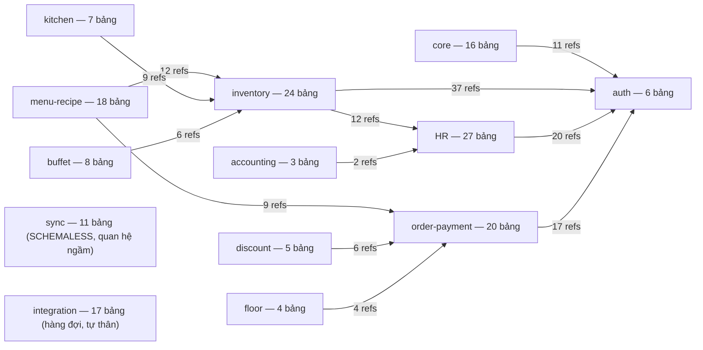
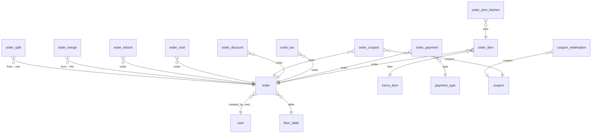

# Báo cáo đánh giá cấu trúc & sơ đồ quan hệ cơ sở dữ liệu

> **Ngày:** 2026-11-03 · **Nhánh:** `authorization` · **Commit:** `626e11a`
> **Phạm vi:** Đếm và phân loại **toàn bộ bảng trong DB**, đánh giá **cấu trúc quan hệ** giữa các bảng, đánh giá **mức độ đầy đủ của sơ đồ quan hệ** trong tài liệu hiện có, và **bổ sung bộ ERD đầy đủ** (13 sơ đồ theo domain + 1 sơ đồ liên-domain).
> **Số liệu live** lấy trực tiếp từ MySQL 8 đang chạy trong Docker (`restaurant-pos-mysql-1`, database `restaurant_manager`).

---

## 1. Tóm tắt (TL;DR)

| Câu hỏi | Câu trả lời |
|---|---|
| **DB có bao nhiêu bảng?** | **7 bảng vật lý** trong MySQL + **169 bảng logic** của ứng dụng (định nghĩa trong `migrations/latest.surql`). Ở tầng vật lý MySQL chỉ "thấy" 7 bảng; 169 bảng nghiệp vụ được lưu trong bảng JSON `records`. |
| **Bảng nào đang có dữ liệu?** | **44/169** bảng nghiệp vụ có dữ liệu (2.280 dòng `records`) + mirror `tracking_events` (1 dòng). Số còn lại là bảng được định nghĩa sẵn cho luồng chưa dùng đến (integration, buffet, HR nâng cao…). |
| **Có bao nhiêu quan hệ?** | **441 quan hệ** kiểu `record<bảng>` được khai báo tường minh bằng `DEFINE FIELD … TYPE record<…>`, trỏ tới **80 bảng đích**; trong đó **51 quan hệ 1-n dạng `array<record<…>>`**. |
| **Bảng nào là "trung tâm"?** | `user` (được tham chiếu 100 lần), `inventory_item` (24), `inventory_location` (22), `inventory_store` (21), `document` (16), `order` (14), `employee` (14), `order_item` (10), `tax` (10). |
| **Tài liệu sơ đồ quan hệ hiện có đã đủ chưa?** | **Chưa.** Trước báo cáo này, repo **không có ERD nào** cho 169 bảng nghiệp vụ — tài liệu DB duy nhất (`MIGRATION-MYSQL.md`) chỉ vẽ sơ đồ 6 bảng vật lý của lớp lưu trữ; `docs/user-guide/STRUCTURE.md` mô tả cấu trúc **màn hình**, không phải cấu trúc dữ liệu. → Bộ ERD 13 domain đã được bổ sung vào **`docs/erd/`** kèm báo cáo này. |
| **Cơ chế nào bảo đảm quan hệ?** | Không dùng FOREIGN KEY vật lý. Quan hệ được đảm bảo 3 lớp: (1) kiểu tường minh `record<t>` trong schema, (2) **48 `DEFINE INDEX … UNIQUE`** (live DB: 43) chống trùng lặp/đảo chiều, (3) **9 `DEFINE EVENT`** tự ghi `audit_log` khi ghi. Toàn bộ thực thi ở **dbproxy** khi ghi (học từ schema), không phải engine MySQL. |

---

## 2. Kiến trúc lưu trữ: 2 tầng bảng

Hệ thống dùng kiến trúc **"store trong store"** — di sản của lần migrate SurrealDB → PostgreSQL → MySQL (xem [`MIGRATION-MYSQL.md`](MIGRATION-MYSQL.md)):

```
Tầng 1 — LOGICAL (169 bảng nghiệp vụ, ngôn ngữ SurrealQL)
  migrations/latest.surql: 169 DEFINE TABLE · 1.527 DEFINE FIELD
                            · 175 DEFINE INDEX (48 UNIQUE) · 9 DEFINE EVENT
        │  client (frontend + 5 sidecar) gửi SurrealQL qua WebSocket /rpc
        ▼
dbproxy (Node) — parser/eval SurrealQL, KHÔNG chứa SQL nghiệp vụ
        │  thực thi ràng buộc: unique, default, event, học kiểu field
        ▼
Tầng 2 — PHYSICAL (MySQL 8, database restaurant_manager) — 7 bảng:
  records          (table_name, id, data JSON)   ← toàn bộ 169 bảng nằm ở đây
  field_kinds      78 dòng   — kiểu dữ liệu đã học per (bảng, field)
  unique_indexes   43 dòng   — ràng buộc UNIQUE đang được enforce khi ghi
  field_defaults  280 dòng   — biểu thức DEFAULT áp khi CREATE
  event_defs        9 dòng   — DEFINE EVENT (audit) chạy khi ghi
  change_log    4.565 dòng   — watermark đồng bộ/LIVE (seq AUTO_INCREMENT)
  tracking_events   1 dòng   — mirror phân tích của tracking-api (opt-in)
```

**Vì sao 169 bảng "núp" trong 1 bảng?** Nhờ đó frontend và 5 sidecar giữ nguyên giao thức SurrealDB (record id `table:id`, FETCH, GROUP, LIVE) sau 2 lần đổi engine — **0 dòng nghiệp vụ phải sửa**. MySQL chỉ là kv-JSON có only khóa `(table_name, id)`, collation `utf8mb4_bin` để id không va chạm hoa-thường/dấu tiếng Việt.

> ⚠️ Hệ quả cần biết: **không có FOREIGN KEY vật lý**, không có kiểu cột per-nghiệp-vụ, không index được sâu vào JSON ngoài `table_name + id`. Đây là đánh đổi có chủ đích của kiến trúc local-first + đồng bộ đa chi nhánh (ADR 0001/0002).

---

## 3. Số lượng bảng — đếm chính xác

| Tầng | Nguồn đếm | Kết quả |
|---|---|---|
| Bảng vật lý MySQL (Docker live) | `information_schema.tables` | **7** |
| Bảng logic định nghĩa trong schema | `grep DEFINE TABLE migrations/latest.surql` | **169** (= 168 bảng nghiệp vụ + `_schema_migration`) |
| — trong đó SCHEMAFULL (bắt kiểu tường minh) | | **141** |
| — trong đó SCHEMALESS (tự do, cấu trúc do code quản) | | **28** |
| — bảng không định nghĩa field nào (`DEFINE FIELD`) | | **15** (toàn bộ thuộc sync_*, một số integration_*, self_order_*) |
| Bảng logic có dữ liệu (Docker live) | `SELECT table_name, COUNT(*) FROM records GROUP BY 1` | **44** |
| Tổng dòng records (Docker live) | | **2.280** |
| Tổng dòng change_log / max seq | | 4.565 / 4.565 |

### 3.1 7 bảng vật lý — cấu trúc cột

| Bảng | Cột | Vai trò |
|---|---|---|
| `records` | `table_name VARCHAR(128)` + `id VARCHAR(512)` (PK ghép), `data JSON`, `created_at`, `updated_at TIMESTAMP(3)` | Kho dữ liệu duy nhất của 169 bảng nghiệp vụ |
| `field_kinds` | `(table_name, field)` PK, `kind` | Học kiểu wire per-field (`rid`, `datetime`, `decimal`, `uuid`, `duration`…) để đọc ra đúng kiểu |
| `unique_indexes` | `name` PK, `table_name`, `fields JSON` | Danh sách UNIQUE đang enforce khi ghi |
| `field_defaults` | `(table_name, field)` PK, `expr JSON` | Biểu thức DEFAULT (`time::now()`…) áp khi CREATE |
| `event_defs` | `name` PK, `table_name`, `when_ast JSON`, `then_statements JSON` | 9 DEFINE EVENT ghi `audit_log` |
| `change_log` | `seq BIGINT AUTO_INCREMENT` PK, `table_name`, `record_id`, `action`, `data JSON`, `at` | Thay thế changefeed của SurrealDB; watermark cho sync & LIVE |
| `tracking_events` | `tracking_id` PK, `created_at`, `page`, `user_id`, `module`, `payload JSON` | Mirror phân tích của tracking-api (bảng 8 của hệ thống nếu bật profile analytics) |

### 3.2 44 bảng logic đang có dữ liệu (live)

Top theo số dòng: `sync_event` 905 · `sync_accepted_operation` 905 · `tracking` 303 · `_schema_migration` 49 · `inventory_uom` 15 · `account` 14 · `audit_log` 7 · `user` 7 · `user_role` 6 · `employee` 6 · `integration_installed_provider` 6 · `security_alert_rules` 6 … (danh sách đủ 44 bảng ở **Phụ lục A**).

`sync_event` = `sync_accepted_operation` = 905 là cặp 1-1 của giao thức sync đa chi nhánh (mỗi event được chấp nhận lưu bản ghi ứng).

---

## 4. Cấu trúc quan hệ giữa các bảng

### 4.1 Cơ chế khai báo quan hệ

Quan hệ được khai báo **tường minh trong schema** bằng kiểu record:

```surql
DEFINE FIELD group ON account TYPE none | record<account_group> | null …      -- n-1
DEFINE FIELD lines ON account_journal_entry TYPE none | array<record<account_journal_line>> …  -- 1-n nhúng
DEFINE FIELD documents.* ON account_journal_entry TYPE record<document> …     -- kiểu phần tử của mảng
```

- **441 quan hệ** tường minh (`record<…>`), trỏ tới **80 bảng đích**.
- **51/441 là mảng** (`array<record<…>>`) — mẫu "cha giữ mảng con" của SurrealDB.
- Chiều được đọc: bảng A có field trỏ `record<B>` ⇒ A-n : B-1 (nhiều A trỏ một B).

### 4.2 Các bảng hub (được tham chiếu nhiều nhất)

| Bảng đích | Số field đang trỏ tới | Vai trò |
|---|---:|---|
| `user` | **100** | Danh tính của mọi tác vụ (created_by, actor, recorded_by… toàn hệ thống) |
| `inventory_item` | 24 | Hàng hóa — lõi của kho, buffet, bếp, menu |
| `inventory_location` | 22 | Điểm kho (location) của mọi phiếu kho |
| `inventory_store` | 21 | Nhà kho/chi nhánh kho |
| `document` | 16 | Tệp đính kèm chung (HR, kế toán…) |
| `order` | 14 | Đơn hàng — lõi bán hàng |
| `employee` | 14 | Nhân sự |
| `order_item` | 10 | Dòng món của đơn |
| `tax` | 10 | Thuế áp cho menu/đơn |
| `kitchen` | 8 | Điểm bán bếp |

> Nhận xét: mô hình "mọi thứ trỏ về `user`/`document`" là pattern cross-cutting điển hình; `inventory_*` là cụm dày quan hệ nhất (146 cạnh nội bộ domain).

### 4.3 Mẫu thiết kế quan hệ lặp lại

1. **Master–detail phiếu + dòng:** `inventory_purchase` + `inventory_purchase_item`, `inventory_issue` + `inventory_issue_item`, `inventory_purchase_return` + `_item`, `stock_transfer` + `stock_transfer_item`, `inventory_adjustment` + `_item`, `inventory_item_waste` + `_item`, `order` + `order_item` + `order_item_kitchen`, `kitchen_reconciliation` + `_item`, `production_batch` + `input`/`output`, `payroll_run` + `payroll_snapshot`… — cha nắm mảng con **và** con có field ngược trỏ cha (quan hệ hai chiều tường minh).
2. **Bảng nối nhiều-nhiều:** `menu_menu_item` (menu↔menu_item), `menu_menu_item_tax` (thêm thuộc tính lên cạnh), `menu_item_modifier_group`, `inventory_item_group_item`, `employee_assignment_history`.
3. **Snapshot/đóng băng:** `payroll_snapshot`, `buffet_stock_snapshot`, `day_closing`, `kitchen_reconciliation_revision` — lưu trạng thái tại thời điểm chốt, tránh join dữ liệu sống.
4. **Hàng đợi/con trỏ sync (SCHEMALESS, quan hệ ngầm):** `sync_event` ↔ `sync_accepted_operation` (khớp qua `event_id` UNIQUE), `sync_cursor`/`sync_cloud_cursor`/`sync_catalog_down_cursor` (watermark per terminal), `sync_conflict`, `sync_terminal` — **không có `DEFINE FIELD` nào**; cấu trúc và quan hệ do `sync-service` đảm bảo bằng code. Đây là phần **yếu nhất về khai báo quan hệ** (xem §6).
5. **Audit tự động:** 9 DEFINE EVENT (user, user_role, payment_type, payroll_run, account_journal_entry, integration_oauth_credential…) tự `CREATE audit_log` — `audit_log` lưu `table_name`/`record_id` dạng **string**, quan hệ mềm, không `record<>`.

### 4.4 Ràng buộc toàn vẹn — ai bảo đảm gì

| Ràng buộc | Cơ chế | Số lượng |
|---|---|---|
| Không trùng khóa nghiệp vụ (code, email, slug…) | `DEFINE INDEX … UNIQUE` do dbproxy kiểm khi ghi | 48 định nghĩa / 43 đang enforce live |
| Giá trị mặc định | `DEFINE FIELD … DEFAULT` do dbproxy áp khi CREATE | 280 |
| Ghi audit khi tạo/sửa/xóa | `DEFINE EVENT` do dbproxy chạy | 9 |
| Kiểu dữ liệu field | `field_kinds` học từ wire + schema SCHEMAFULL | 78 (table,field) đã học live |
| **Khóa ngoại** | **KHÔNG có** — quan hệ chỉ là chuỗi `table:id` trong JSON; sai id không bị DB chặn | — |

---

## 5. Sơ đồ quan hệ (ERD)

### 5.1 Bản đồ liên-domain (mới bổ sung — [`docs/erd/_domains.mmd`](erd/_domains.mmd))



`auth` (đặc biệt `user`) là điểm hội tụ của toàn hệ thống: 103 cạnh đi vào từ các domain khác.

### 5.2 ERD domain Đơn hàng & Thanh toán (20 bảng — [`docs/erd/order-payment.mmd`](erd/order-payment.mmd))



*(bản đầy đủ 47 cạnh trong file)*

### 5.3 ERD domain Kho (24 bảng, 146 cạnh nội bộ — [`docs/erd/inventory.mmd`](erd/inventory.mmd))

Đặc trưng: cụm "phiếu + dòng" dày đặc (`inventory_purchase(_item)`, `inventory_issue(_item/_return/_return_item)`, `stock_transfer(_item)`, `inventory_item_waste(_item)`, `inventory_adjustment(_item)`), tất cả đều trỏ về `inventory_item`, `inventory_location`, `inventory_store`, `inventory_supplier`, `inventory_uom` và `employee` (người làm phiếu).

### 5.4 Bộ ERD đầy đủ (13 file, 441 cạnh — thư mục `docs/erd/`)

| File | Domain | Bảng | Cạnh nội bộ | Cạnh ra/vào |
|---|---|---:|---:|---|
| `inventory.mmd` | Kho | 24 | 146 | 54 / 32 |
| `hr.mmd` | HR, ca, lương, nghỉ phép | 27 | 70 | 21 / 17 |
| `order-payment.mmd` | Đơn hàng & thanh toán | 20 | 69 | 31 / 18 |
| `menu-recipe.mmd` | Thực đơn, công thức, sản xuất | 18 | 50 | 27 / 12 |
| `core.mmd` | Khách hàng, cửa hàng, settings, audit | 16 | 32 | 22 / 13 |
| `integration.mmd` | Tích hợp nhà cung cấp dịch vụ | 17 | 1 | 1 / 0 |
| `sync.mmd` | Đồng bộ đa chi nhánh (SCHEMALESS) | 11 | 0 | 0 / 0 |
| `buffet.mmd` | Buffet | 8 | 23 | 15 / 0 |
| `kitchen.mmd` | Bếp, đối soát,_staff meal | 7 | 27 | 19 / 0 |
| `auth.mmd` | Tài khoản, phiên, cảnh báo bảo mật | 6 | 2 | 1 / 103 |
| `discount.mmd` | Giảm giá, coupon | 5 | 7 | 6 / 6 |
| `floor.mmd` | Sàn nhà, bàn, self-order | 4 | 7 | 6 / 5 |
| `accounting.mmd` | Sổ kế toán | 3 | 7 | 4 / 1 |
| `_domains.mmd` | Bản đồ liên-domain | 15 nhóm | — | 41 cạnh liên-domain |

Mỗi ERD vẽ entity với id (PK) + ghi chú số field; cạnh `}o--||` với nhãn số field tham chiếu (mảng được ghi `(incl. array)`).

---

## 6. Đánh giá: sơ đồ quan hệ hiện có đã đủ chưa?

### 6.1 Trước báo cáo này

| Tài liệu | Có gì | Thiếu gì |
|---|---|---|
| [`MIGRATION-MYSQL.md`](MIGRATION-MYSQL.md) | Sơ đồ kiến trúc **7 bảng vật lý** + ánh xạ phương ngữ SQL | Không vẽ bảng nghiệp vụ nào |
| [`docs/adr/0001…0007`](adr/) | Quyết định kiến trúc (local-first, changefeed, catalog, MySQL mirror) | Không có ERD |
| [`docs/user-guide/STRUCTURE.md`](user-guide/STRUCTURE.md) | Cấu trúc **chức năng** (màn hình, module) | Không phải cấu trúc dữ liệu |
| `dbproxy/src/store.mjs` | DDL 6 bảng vật lý, chú thích vai trò | — |

**Kết luận: chưa đủ.** Không tồn tại bất kỳ sơ đồ quan hệ nào cho 169 bảng nghiệp vụ — dù schema định nghĩa tới 441 quan hệ. Với hệ thống 169 bảng, 14 domain, người mới không thể nắm mô hình dữ liệu nếu không đọc trực tiếp 3.249 dòng `latest.surql`.

### 6.2 Sau báo cáo này (đã bổ sung)

- ✅ ERD 13 domain + 1 bản đồ liên-domain (Mermaid, render trực tiếp trên GitHub) trong `docs/erd/`.
- ✅ Bảng kê 169 bảng đầy đủ (Phụ lục A): domain, số field, số ref đi/đến, số UNIQUE index, số dòng live.
- ✅ Định lượng mọi con số: 7 vật lý / 169 logic / 44 có dữ liệu / 441 quan hệ / 48 UNIQUE / 9 event.

### 6.3 Đánh giá chất lượng mô hình quan hệ

**Điểm mạnh**

1. Quan hệ khai báo tường minh, có kiểu (`record<t>`), tra cứu được bằng máy (chính là nguồn sinh ERD trong báo cáo này) — tốt hơn nhiều schema JSON "free-form".
2. Ràng buộc UNIQUE phân bố rộng: 95/169 bảng có ít nhất 1 unique index; các cặp phiếu-dòng đều có unique ngược (`(entry, line)`, `(order, item)`…).
3. Mẫu master–detail nhất quán trên toàn bộ các phiếu (kho, bếp, kế toán, đơn hàng) — học một lần hiểu cả cụm.
4. Audit tự động bằng event thay vì rải code; `change_log` cho đồng bộ tăng trưởng (delta sync) và LIVE query.

**Điểm yếu / rủi ro (quan trọng nhất đầu tiên)**

1. **15 bảng SCHEMALESS không định nghĩa field** (toàn bộ `sync_*`, một số `self_order_*`, `integration_*`): quan hệ và cấu trúc chỉ tồn tại trong code `sync-service`/frontend. ERD không thể sinh tự động cho phần này (trong ERD domain sync hiện là "lưu ý ngầm"). *Khuyến nghị:* thêm DEFINE FIELD tối thiểu cho `sync_event`, `sync_accepted_operation`, `sync_cursor*` để schema tự mô tả.
2. **Không có khóa ngoại vật lý**: xóa `menu_item` không bị DB chặn dù `order_item.item` đang trỏ tới. Ràng buộc tham chiếu hoàn toàn trách nhiệm của ứng dụng. Với mô hình local-first + sync đa chi nhánh đây là đánh đổi được chấp nhận (ADR 0001/0002), nhưng cần **kèm công cụ kiểm orphan** định kỳ.
3. **Quan hệ hai chiều trùng lặp** (cha nắm mảng con **và** con trỏ cha) — tiện đọc, nhưng cần code ghi cẩn thận để tránh lệch hai phía; hiện không có invariant nào kiểm.
4. Schema định nghĩa **48 UNIQUE** nhưng live DB chỉ enforce **43** (5 thêm sau lần schema áp cuối `2026_10_31_optional_array_null`); chênh lệch tự phục vụ khi client chạy schema lần sau, không phải lỗi dữ liệu.
5. 125/169 bảng chưa có dữ liệu trong môi trường live này (đa phần luồng integration/buffet/HR nâng cao) — cấu trúc được khai báo nhưng **chưa được kiểm chứng bằng dữ liệu thật** ở các luồng đó.

---

## 7. Kết luận

1. Hệ thống có **7 bảng vật lý MySQL** và **169 bảng logic nghiệp vụ** (141 SCHEMAFULL + 28 SCHEMALESS), hiện **44 bảng có dữ liệu** (2.280 dòng).
2. Cấu trúc quan hệ **tốt và tường minh** ở tầng schema: 441 quan hệ `record<>`, 80 bảng đích, 48 UNIQUE, 9 event audit, pattern master–detail nhất quán; trung tâm là `user`, `inventory_item/location/store`, `order`, `employee`.
3. **Tài liệu sơ đồ quan hệ trước đây chưa đủ (không có ERD nào)** — báo cáo này đã bổ sung bộ ERD đầy đủ 14 sơ đồ tại `docs/erd/` + bảng kê toàn bộ 169 bảng (Phụ lục A).
4. Hai việc nên làm tiếp: (a) khai báo field cho 15 bảng sync/self-order SCHEMALESS, (b) script kiểm orphan-reference định kỳ vì DB không có khóa ngoại.

---

## Phụ lục A — Bảng kê 169 bảng logic

Số liệu: `fields` = số `DEFINE FIELD` (đường dẫn, tính cả `. *` của mảng vào field cha); *Refs đi* = số field của bảng này trỏ ra bảng khác; *Refs đến* = số field của bảng khác trỏ vào bảng này; *Rows live* = số dòng trong `records` của MySQL đang chạy (— = chưa có dữ liệu).

**Core (nghiệp vụ chung)** (16 bảng)

| Bảng | Fields | Refs đi | Refs đến | UNIQUE idx | Rows live |
|---|---:|---:|---:|---:|---:|
| `account` | 10 | 2 | 2 | 1 | 14 |
| `audit_log` | 11 | 0 | 0 | 4 | 7 |
| `customer` | 14 | 2 | 2 | 0 | — |
| `customer_address` | 8 | 0 | 2 | 0 | — |
| `day_closing` | 25 | 2 | 0 | 2 | — |
| `kitchen` | 7 | 4 | 8 | 0 | 1 |
| `notes` | 1 | 0 | 0 | 0 | — |
| `setting` | 4 | 1 | 0 | 1 | 2 |
| `stock_transfer` | 18 | 11 | 1 | 4 | — |
| `stock_transfer_item` | 6 | 2 | 0 | 2 | — |
| `tip_distribution` | 8 | 4 | 0 | 0 | — |
| `tip_distribution_user_share` | 3 | 1 | 2 | 0 | — |
| `tracking` | 13 | 0 | 0 | 2 | 303 |
| `work_schedule` | 6 | 1 | 1 | 1 | — |
| `workflow` | 3 | 0 | 4 | 0 | 1 |
| `workflow_stage` | 5 | 2 | 1 | 1 | 1 |

**Auth & phân quyền** (6 bảng)

| Bảng | Fields | Refs đi | Refs đến | UNIQUE idx | Rows live |
|---|---:|---:|---:|---:|---:|
| `auth_permission` | 0 | 0 | 2 | 0 | — |
| `revoked_session` | 3 | 0 | 0 | 2 | — |
| `security_alert_rules` | 8 | 0 | 0 | 2 | 6 |
| `security_alerts` | 16 | 0 | 0 | 5 | — |
| `user` | 12 | 2 | 100 | 0 | 7 |
| `user_role` | 4 | 0 | 2 | 0 | 6 |

**HR & lịch làm việc** (27 bảng)

| Bảng | Fields | Refs đi | Refs đến | UNIQUE idx | Rows live |
|---|---:|---:|---:|---:|---:|
| `cost_center` | 5 | 0 | 5 | 1 | — |
| `department` | 5 | 0 | 5 | 1 | 2 |
| `document` | 5 | 0 | 16 | 0 | — |
| `employee` | 17 | 5 | 14 | 3 | 6 |
| `employee_assignment_history` | 10 | 6 | 0 | 1 | — |
| `employee_document` | 7 | 3 | 0 | 1 | — |
| `employee_pay_profile` | 18 | 6 | 1 | 1 | — |
| `employee_performance_note` | 8 | 2 | 0 | 1 | — |
| `labor_adjustment` | 11 | 4 | 0 | 1 | — |
| `labor_audit_log` | 5 | 1 | 0 | 1 | — |
| `labor_cost_event` | 7 | 1 | 0 | 1 | — |
| `labor_pay_rule` | 9 | 0 | 0 | 2 | — |
| `labor_policy` | 6 | 0 | 5 | 1 | — |
| `leave_balance` | 7 | 2 | 0 | 1 | — |
| `leave_request` | 12 | 5 | 0 | 1 | — |
| `leave_type` | 8 | 0 | 2 | 1 | — |
| `payroll_period` | 9 | 1 | 2 | 1 | — |
| `payroll_run` | 8 | 3 | 2 | 1 | — |
| `payroll_snapshot` | 29 | 4 | 0 | 2 | — |
| `position` | 6 | 2 | 4 | 1 | — |
| `public_holiday` | 8 | 1 | 0 | 1 | — |
| `schedule_template` | 12 | 4 | 0 | 0 | — |
| `scheduled_shift` | 10 | 6 | 3 | 2 | — |
| `shift` | 5 | 0 | 5 | 0 | 2 |
| `shift_swap_request` | 8 | 6 | 0 | 0 | — |
| `time_entry` | 16 | 6 | 2 | 3 | 2 |
| `time_entry_break` | 6 | 2 | 0 | 1 | — |

**Kho (inventory)** (24 bảng)

| Bảng | Fields | Refs đi | Refs đến | UNIQUE idx | Rows live |
|---|---:|---:|---:|---:|---:|
| `inventory_adjustment` | 18 | 9 | 1 | 4 | — |
| `inventory_adjustment_item` | 10 | 4 | 2 | 3 | — |
| `inventory_category` | 2 | 0 | 1 | 0 | 1 |
| `inventory_issue` | 23 | 15 | 5 | 5 | — |
| `inventory_issue_item` | 12 | 4 | 4 | 2 | — |
| `inventory_issue_return` | 21 | 14 | 2 | 5 | — |
| `inventory_issue_return_item` | 13 | 6 | 2 | 2 | — |
| `inventory_item` | 16 | 7 | 24 | 0 | 1 |
| `inventory_item_group` | 4 | 3 | 0 | 0 | — |
| `inventory_item_group_item` | 2 | 1 | 2 | 0 | — |
| `inventory_item_waste` | 18 | 11 | 1 | 4 | — |
| `inventory_item_waste_item` | 15 | 6 | 7 | 2 | — |
| `inventory_ledger` | 17 | 4 | 1 | 4 | 2 |
| `inventory_location` | 6 | 2 | 22 | 2 | 2 |
| `inventory_purchase` | 30 | 16 | 8 | 6 | 2 |
| `inventory_purchase_item` | 24 | 5 | 4 | 2 | 2 |
| `inventory_purchase_order` | 17 | 11 | 2 | 6 | — |
| `inventory_purchase_order_item` | 8 | 3 | 2 | 0 | — |
| `inventory_purchase_payment` | 5 | 3 | 2 | 0 | — |
| `inventory_purchase_return` | 19 | 12 | 1 | 5 | — |
| `inventory_purchase_return_item` | 13 | 6 | 2 | 2 | — |
| `inventory_store` | 1 | 0 | 21 | 0 | — |
| `inventory_supplier` | 8 | 4 | 8 | 0 | 1 |
| `inventory_uom` | 7 | 0 | 0 | 3 | 15 |

**Tích hợp bên thứ ba** (17 bảng)

| Bảng | Fields | Refs đi | Refs đến | UNIQUE idx | Rows live |
|---|---:|---:|---:|---:|---:|
| `integration_entity_mapping` | 7 | 0 | 0 | 2 | — |
| `integration_execution_history` | 7 | 0 | 0 | 0 | — |
| `integration_installed_provider` | 3 | 0 | 0 | 0 | 6 |
| `integration_oauth_credential` | 10 | 0 | 0 | 1 | — |
| `integration_oauth_state` | 6 | 0 | 0 | 1 | — |
| `integration_order_fiscal` | 13 | 1 | 0 | 2 | — |
| `integration_provider` | 5 | 0 | 0 | 0 | — |
| `integration_provider_certificate` | 4 | 0 | 0 | 0 | — |
| `integration_provider_config` | 3 | 0 | 0 | 0 | — |
| `integration_provider_health` | 11 | 0 | 0 | 0 | — |
| `integration_provider_secret` | 0 | 0 | 0 | 0 | — |
| `integration_provider_webhook` | 4 | 0 | 0 | 0 | — |
| `integration_queue` | 11 | 0 | 0 | 0 | — |
| `integration_queue_attempt` | 6 | 0 | 0 | 0 | — |
| `integration_schedule` | 6 | 0 | 0 | 0 | — |
| `integration_sync_failure` | 10 | 0 | 0 | 0 | — |
| `integration_sync_run` | 9 | 0 | 0 | 0 | — |

**Đồng bộ đa chi nhánh** (11 bảng)

| Bảng | Fields | Refs đi | Refs đến | UNIQUE idx | Rows live |
|---|---:|---:|---:|---:|---:|
| `sync_accepted_operation` | 0 | 0 | 0 | 1 | 905 |
| `sync_branch` | 5 | 0 | 0 | 1 | — |
| `sync_catalog_down_cursor` | 0 | 0 | 0 | 0 | — |
| `sync_cloud_cursor` | 0 | 0 | 0 | 0 | — |
| `sync_conflict` | 0 | 0 | 0 | 0 | — |
| `sync_cursor` | 0 | 0 | 0 | 0 | — |
| `sync_event` | 0 | 0 | 0 | 1 | 905 |
| `sync_event_seq` | 0 | 0 | 0 | 0 | 1 |
| `sync_number_counter` | 0 | 0 | 0 | 0 | 2 |
| `sync_number_reservation` | 0 | 0 | 0 | 1 | 1 |
| `sync_terminal` | 0 | 0 | 0 | 1 | 2 |

**Buffet** (8 bảng)

| Bảng | Fields | Refs đi | Refs đến | UNIQUE idx | Rows live |
|---|---:|---:|---:|---:|---:|
| `buffet_consumption_log` | 13 | 2 | 0 | 1 | — |
| `buffet_guest_count` | 5 | 2 | 0 | 1 | — |
| `buffet_menu` | 7 | 1 | 2 | 1 | — |
| `buffet_menu_item` | 4 | 2 | 1 | 1 | — |
| `buffet_production_batch` | 5 | 3 | 0 | 1 | — |
| `buffet_session` | 19 | 5 | 5 | 1 | — |
| `buffet_stock_snapshot` | 8 | 4 | 0 | 1 | — |
| `buffet_waste_log` | 7 | 4 | 0 | 1 | — |

**Bếp & đối soát** (7 bảng)

| Bảng | Fields | Refs đi | Refs đến | UNIQUE idx | Rows live |
|---|---:|---:|---:|---:|---:|
| `kitchen_complimentary_item` | 7 | 5 | 0 | 0 | — |
| `kitchen_reconciliation` | 14 | 6 | 8 | 1 | — |
| `kitchen_reconciliation_item` | 20 | 2 | 0 | 1 | — |
| `kitchen_reconciliation_revision` | 8 | 2 | 0 | 0 | — |
| `kitchen_staff_meal` | 8 | 5 | 0 | 0 | — |
| `kitchen_stock_count` | 5 | 3 | 0 | 1 | — |
| `kitchen_waste` | 7 | 4 | 0 | 0 | — |

**Giảm giá** (5 bảng)

| Bảng | Fields | Refs đi | Refs đến | UNIQUE idx | Rows live |
|---|---:|---:|---:|---:|---:|
| `coupon` | 24 | 0 | 2 | 0 | — |
| `coupon_redemption` | 6 | 4 | 0 | 0 | — |
| `discount` | 30 | 2 | 4 | 1 | — |
| `discount_reason` | 5 | 0 | 1 | 1 | — |
| `role_discount_policy` | 7 | 1 | 0 | 0 | — |

**Sàn nhà & bàn** (4 bảng)

| Bảng | Fields | Refs đi | Refs đến | UNIQUE idx | Rows live |
|---|---:|---:|---:|---:|---:|
| `floor` | 5 | 0 | 4 | 0 | 1 |
| `floor_table` | 26 | 7 | 2 | 0 | 1 |
| `self_order_checkout` | 0 | 0 | 0 | 0 | — |
| `self_order_table` | 0 | 0 | 0 | 1 | 1 |

**Kế toán** (3 bảng)

| Bảng | Fields | Refs đi | Refs đến | UNIQUE idx | Rows live |
|---|---:|---:|---:|---:|---:|
| `account_group` | 8 | 0 | 1 | 1 | 5 |
| `account_journal_entry` | 22 | 5 | 1 | 4 | — |
| `account_journal_line` | 6 | 2 | 2 | 2 | — |

**Catalog HQ/chi nhánh** (2 bảng)

| Bảng | Fields | Refs đi | Refs đến | UNIQUE idx | Rows live |
|---|---:|---:|---:|---:|---:|
| `catalog_branch_override` | 5 | 0 | 0 | 2 | — |
| `catalog_release` | 9 | 0 | 0 | 0 | — |

**Thực đơn & công thức** (18 bảng)

| Bảng | Fields | Refs đi | Refs đến | UNIQUE idx | Rows live |
|---|---:|---:|---:|---:|---:|
| `category` | 8 | 1 | 6 | 0 | 1 |
| `extra` | 1 | 0 | 0 | 0 | — |
| `extras` | 8 | 6 | 0 | 0 | — |
| `menu` | 9 | 2 | 0 | 0 | 1 |
| `menu_item` | 22 | 7 | 8 | 1 | 1 |
| `menu_item_modifier_group` | 7 | 2 | 0 | 0 | — |
| `menu_item_recipe` | 8 | 2 | 2 | 0 | — |
| `menu_menu_item` | 9 | 4 | 3 | 0 | — |
| `menu_menu_item_tax` | 3 | 2 | 0 | 1 | — |
| `modifier` | 5 | 3 | 2 | 0 | — |
| `modifier_group` | 8 | 2 | 3 | 0 | — |
| `printer` | 12 | 0 | 2 | 0 | — |
| `production_batch` | 15 | 4 | 4 | 1 | — |
| `production_batch_input` | 7 | 4 | 0 | 1 | — |
| `production_batch_output` | 10 | 5 | 0 | 1 | — |
| `recipe` | 9 | 2 | 4 | 0 | — |
| `recipe_item` | 7 | 2 | 0 | 0 | — |
| `recipe_output` | 7 | 2 | 1 | 0 | — |

**Hệ thống** (1 bảng)

| Bảng | Fields | Refs đi | Refs đến | UNIQUE idx | Rows live |
|---|---:|---:|---:|---:|---:|
| `_schema_migration` | 3 | 0 | 0 | 1 | 49 |
